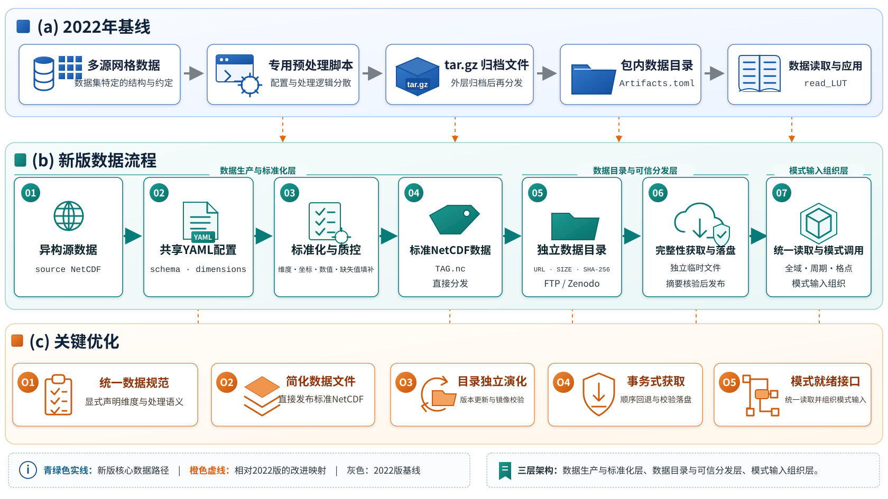
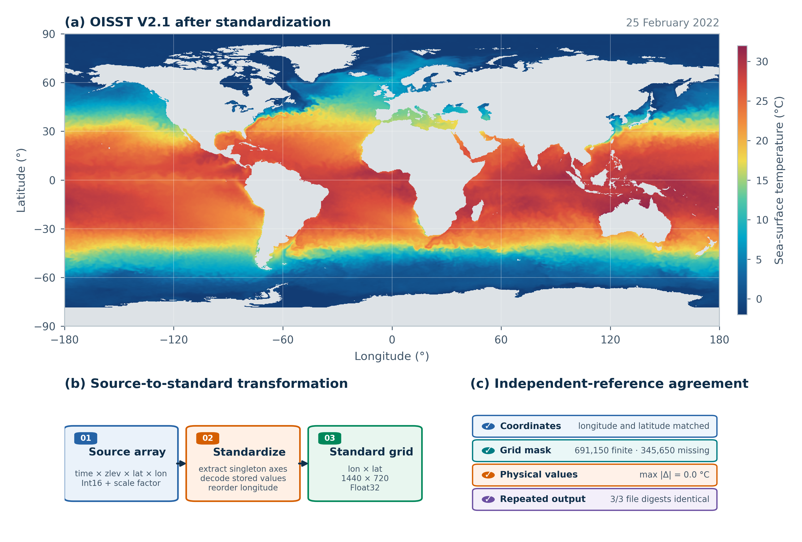
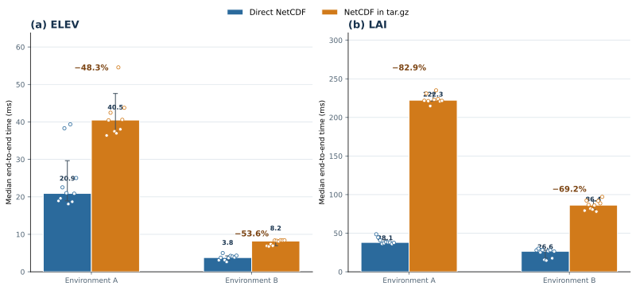

# 面向地球系统模式的全球网格数据库：GriddingMachine框架更新与应用

**姜皓（Hao Jiang）**^1，**王玉杰（Yujie Wang）**^1*

1. 中国科学技术大学地球和空间科学学院，安徽 合肥 230026

姜皓，E-mail：hao.jiang@mail.ustc.edu.cn；ORCID：https://orcid.org/0009-0009-8295-8661

\* 通讯作者：王玉杰，wyujie@ustc.edu.cn

## 摘要

地球系统模式依赖区域至全球尺度的网格数据进行参数初始化及结果验证。尽管当前数据大多已采用NetCDF、HDF、GeoTIFF等标准格式，源数据处理规则、单位换算、标准数据标识和网络分发方式不同等问题，使得各模式仍需分别整理和维护数据库，给模式持续更新和验证带来不必要的困难。本文在2022版GriddingMachine基础上，优化数据预处理、数据分发及数据读取：以共享配置组织数据处理规则，建立统一的标准化流程；采用直接NetCDF分发和独立数据目录，简化文件获取与数据更新；在统一读取基础上组织陆面参数和气象驱动，衔接多源数据与模式输入。应用案例表明，标准化数据与独立参考一致，直接NetCDF分发缩短获取至首次读取的时间，独立目录在数据修订后保持标签调用，多源数据经统一组织形成模式所需输入。除Julia语言外，还完善了Matlab、Octave、Python和R语言对新版数据的自动下载支持，并添加了C语言和Fortran语言的自动下载支持，为不同科研编程环境和地球系统模式提供可复用的网格数据基础。

**关键词：** 地球系统模式；全球网格数据库；数据标准化；NetCDF；数据完整性；模式输入

**A Global Gridded Database for Earth System Models: Advances and Applications of GriddingMachine**

**Hao JIANG^1, Yujie WANG^1\***

1. School of Earth and Space Sciences, University of Science and Technology of China, Hefei 230026, China

Hao Jiang, E-mail: hao.jiang@mail.ustc.edu.cn; ORCID: https://orcid.org/0009-0009-8295-8661

\* Corresponding author: Yujie Wang, wyujie@ustc.edu.cn

## Abstract

Earth system models rely on gridded data at regional to global scales for parameter initialization and evaluation of simulation results. Although most datasets are available in standard formats such as NetCDF, HDF, and GeoTIFF, differences in source-processing rules, unit conversion, standardized data identifiers, and distribution methods require researchers to organize and maintain databases for individual models, complicating continued model development and evaluation. Building on the 2022 release of GriddingMachine, this study improves data preprocessing, distribution, and reading. A shared configuration organizes processing rules within a standardized workflow; direct NetCDF distribution and an independent catalog simplify file acquisition and data updates; and land parameters and meteorological forcing from multiple sources are assembled into model inputs on the basis of unified reading. Application cases show that standardized data agree with independent references, direct NetCDF distribution shortens the time from acquisition to the first read, the independent catalog preserves label-based access after data revisions, and data from multiple sources are organized into the inputs required by the model. In addition to Julia, automatic downloading of the updated data is supported in MATLAB, Octave, Python, and R, with new automatic-download entry points for C and Fortran, providing a reusable gridded-data basis for different scientific programming environments and Earth system models.

**Keywords:** Earth system models; global gridded database; data standardization; NetCDF; data integrity; model input

## 1 引言

地球系统模式的参数初始化、边界条件、气象驱动和结果验证均依赖区域至全球尺度的网格数据。这些数据由不同研究团队和业务机构提供，即使采用相同的文件格式，其坐标排列、空间与时间分辨率、变量含义、单位和缺失值表示仍可能存在差异。研究人员因此需要在数据获取后继续完成转换和整理。此类工作往往随各模式的需求分别开展，源数据或模式接口更新后，相应程序和输入文件还需持续维护。减少同类数据的重复整理，并在更新中保持输入一致，是全球网格数据应用中的实际问题。

科学数据复用需要明确数据的发现、访问和解释方式。FAIR原则强调可发现（**F**indable）、可获取（**A**ccessible）、可互操作（**I**nteroperable）和可复用（**R**eusable）[1]；NetCDF及气候与预报元数据约定（Climate and Forecast Metadata Conventions，CF）为多维数据、坐标和变量属性的表达提供基础[2,3]。Google Earth Engine等云平台通过改善数据表达、发现、访问及计算，提升了大尺度地学数据的访问和分析能力[4]。本地模式试验还需保存可反复调用的处理结果，并记录所用数据版本和转换规则。对于面向固定版本、离线缓存和模式直接调用的工作流，研究人员仍需要把数据转换规则、标准数据标识、网络获取内容和下游模式接口连接起来。因此，建立适用于本地运行的标准化科研数据库，可以集中维护多源数据及其处理结果，为不同模式试验提供一致的数据输入。

Wang等[5]于2022年发布了基于Julia语言的GriddingMachine数据库和软件，将常用于陆面和地球系统模拟的全球数据整理为具有统一空间和变量约定的NetCDF文件，并通过数据标签和软件包内的Artifacts.toml目录实现管理与自动下载，同时提供Julia、Matlab、Octave、Python和R接口。该版本为多源数据的统一访问奠定了基础。随着数据类型和应用需求扩展，原有流程在数据维护和模式接入方面面临新的需求：处理规则主要保存在数据源专用脚本中，新增数据需分别适配；标准NetCDF经外层tar.gz归档后分发，使用时仍需解包，Julia包内的数据目录随软件版本更新，新增或修订数据时需同步维护软件内置目录；在获得标准网格数据后，具体模式所需的参数和气象序列仍由应用程序进一步组合，并完成时间与单位衔接。

针对这些需求，改进应围绕数据转换规则的复用、分发信息的独立维护及模式输入的组织展开。源数据特有的转换规则与通用程序分开，可使新增数据沿用已有处理方法；数据目录独立维护并直接分发NetCDF，可减少更新与获取时的附加步骤；在标准网格读取之后统一处理参数组合、时间轴和单位关系，则可减少各模式重复编写数据接入程序。标准NetCDF和数据标签为这些环节提供共同约定，使处理结果能够持续用于模式试验。

本文从数据预处理、分发与读取三个方面更新2022版GriddingMachine，以共享处理规则和独立数据目录减少重复整理与维护，并在统一读取基础上组织模式输入；同时完善Matlab、Octave、Python和R对新版数据的自动下载支持，新增C和Fortran下载入口。研究通过受控处理实例和真实海表温度数据检验标准化结果，通过高程与叶面积指数数据的分发比较和网络镜像获取评价访问效率与内容一致性，并以Emerald陆面过程模式为应用载体，展示陆面参数与逐时气象数据向模式输入的衔接。

## 2 框架设计与关键方法

### 2.1 总体架构与数据流程

为使源数据更新、文件分发和模式接入能够分别维护，新版GriddingMachine将数据流程组织为三个相互衔接的环节（图1）。数据生产与标准化层依据源数据和以文本配置格式YAML保存的处理规则，完成维度、坐标、数值转换和质量检查，输出标准NetCDF文件；数据目录与可信分发层登记数据标签、版本、镜像和完整性信息，负责目录更新、文件下载与内容核验；模式输入组织层读取已获取的标准化数据，完成格点提取、陆面参数融合和气象驱动组织。数据生产主要由GriddingMachineDatasets承担，目录管理、文件获取和模式输入组织主要由GriddingMachine.jl承担。

**图1 GriddingMachine从2022版基线到新版数据流程的架构更新** （a）2022版以数据集专用脚本、`tar.gz`文件、包内数据目录和读取函数`read_LUT`构成数据预处理、分发与读取路径；（b）新版由数据生产与标准化层、数据目录与可信分发层和模式输入组织层构成，依次连接异构源数据、共享YAML配置、标准化与质量控制、标准NetCDF、独立数据目录、完整性获取以及统一读取和模式调用；（c）O1—O5依次表示统一数据规范、简化数据文件、目录独立演化、事务式获取和模式就绪接口。橙色虚线标示各项更新相对于2022版基线及新版核心节点的对应关系。

**Fig. 1 Architectural updates from the 2022 GriddingMachine baseline to the updated data workflow.** (a) The 2022 release linked dataset-specific preprocessing, `tar.gz` distribution, an in-package catalog, and `read_LUT`. (b) The updated framework connects configuration-driven standardization, direct NetCDF distribution, an independent catalog with integrity-verified acquisition, and model-input organization. (c) O1--O5 summarize updates to data specifications, file distribution, catalog maintenance, transactional acquisition, and model-ready interfaces. Orange dashed lines link these updates to the corresponding baseline components and updated workflow nodes.

标准NetCDF和数据标签连接上述环节：生产流程输出以标签命名的文件，目录建立标签与文件地址的对应关系，科研程序再依据标签获取和读取数据。数据源变化时可调整处理配置，分发位置变化时可更新目录，模式侧则沿用统一读取方式，并根据自身接口组织输入。各环节的具体方法见第2.2—2.4节。

表1概括2022版与新版的主要差异及其在数据流程中的作用。

**表1 2022版与新版GriddingMachine的功能和技术路线比较**

**Table 1 Comparison between the 2022 release and the updated GriddingMachine.** The table summarizes the implemented mechanisms, workflow changes, and their implications for scientific data use across the data workflow.

| 环节 | 2022版 | 新版 | 对科研流程的作用 |
|---|---|---|---|
| 分发单元 | NetCDF的`tar.gz`归档文件 | 可直接读取的`.nc` | 简化数据获取并降低端到端读取时间 |
| 数据目录 | Julia包内置`Artifacts.toml` | 独立`Artifacts.yaml`，支持目录校验和独立更新 | 数据目录可独立于软件版本维护 |
| 数据获取 | 基于哈希标识管理数据，支持多个URL、摘要核验和解包 | 直接NetCDF获取、多镜像回退、临时文件核验后更新正式文件 | 简化获取步骤，并保持镜像切换时的文件内容一致 |
| 数据读取接口 | 以`read_LUT`提供全域网格、周期切片和指定格点读取 | 以`read_dataset`统一读取入口，保留`read_LUT`兼容名称，并衔接参数与气象输入组织 | 沿用已有读取方式，为模式输入组织提供基础，并降低旧接口迁移成本 |
| 多语言访问 | 提供Julia、Matlab、Octave、Python和R接口 | 在保留原有接口的基础上完善Matlab、Octave、Python和R自动下载，并新增C和Fortran自动下载入口 | 扩展科研人员获取新版网格数据的编程环境 |
| 模式组织 | 标准化数据和通用读取 | 陆面参数融合与气象驱动组织 | 标准化数据进入Emerald参数组织与模式初始化 |
| 数据生产 | 数据源专用处理及贡献流程 | 共享YAML配置规范、程序化与交互式配置生成及显式源维度映射 | 形成共享的标准化数据生产工作流 |

研究所用目录版本收录1179个数据条目，包括高程与陆地掩膜、土壤水力性质、植被结构与叶片属性，以及气象驱动等数据。地形和土壤属性用于描述格点的基础陆面条件，植被数据包含季节变化信息，逐时气象数据提供模式运行的外部驱动。数据标签按类别、空间与时间分辨率、年份和版本组织；各条目登记机构文件传输协议（File Transfer Protocol，FTP）地址，部分同时配置Zenodo镜像。预定义陆面参数集合将土壤、冠层和叶片等数据按字段组合，气象驱动集合则按变量和年份组织逐时数据，便于科研程序按格点与年份获取输入。目录版本与统计记录见补充材料S7。

### 2.2 YAML驱动的数据生产与标准化

#### 2.2.1 数据规范与维度映射

GriddingMachine采用NetCDF格式组织多维数组、坐标和自描述元数据，便于不同地球科学软件读取[2]。2022 年版本已经规定数据采用二维或三维规则经纬网，前两维依次为经度和纬度，可选第三维表示周期；经度自西向东、纬度自南向北，输出保存为实际物理值，缺失值在读取后统一表示为 `NaN`，主变量和不确定性变量分别命名为 `data` 和 `std`[5]。新版延续这些核心约定，并将源维度映射、处理记录、版本化配置和分发完整性纳入相互衔接的机器可读规范（表2）。

**表2 GriddingMachine 标准 NetCDF 数据与元数据规范**

**Table 2 Standardized NetCDF data and metadata requirements of GriddingMachine.** The specification connects grid structure, gap filling, metadata, provenance, versioning, and distribution integrity within a unified standardization workflow.

| 类别 | 新版规范 | 实现方式 |
|---|---|---|
| 文件与网格 | 一个标签对应一个可直接读取的`.nc`；规则经纬度网格，默认全球覆盖并声明坐标参考 | NetCDF统一保存数据、坐标与自描述元数据 |
| 维度 | 二维`(lon, lat)`；三维`(lon, lat, ind)`；源维度按名称映射到标准顺序 | 通用维度映射将多种源排列转换为统一结构 |
| 坐标方向 | `lon`自西向东并统一到`[-180, 180)`；`lat`自南向北 | 翻转和循环平移保持数据与坐标同步 |
| 数据变量 | `data`为主变量；`std`保存同形不确定性；输出为实际物理值 | 统一变量命名、类型、单位和数值表达 |
| 缺失值填补与范围 | 有效范围、填充值和缺失值填补策略由YAML显式声明 | 支持数值常数、`MEAN`、`KEEP_AS_IS`、`INT_NAN_TO_1`、`NO_LAND_NAN`和`NO_NAN` |
| 变量元数据 | `data/std`记录可读说明、单位及处理变更条目 | 输出文件保留变量语义与主要转换过程 |
| 处理记录 | YAML文件明确记录维度、坐标、数值转换和缺失值填补规则；处理完成后，输出NetCDF文件的属性中同步保存实际执行的变更记录 | 配置意图与数据集处理历史相互对应 |
| 处理复现 | `SCHEMA_VERSION`、完整YAML、固定输入和版本化项目环境共同归档 | 配置、输入与代码版本共同重建标准化数据 |
| 标签与版本 | 标签表达类别、空间/时间分辨率、年份、版本和可选修订号 | 标签与文件名共同形成稳定数据集标识 |
| 分发完整性 | 新登记的条目或纳入严格完整性管理的条目记录文件字节数和SHA-256摘要（用于核验文件内容一致性）；同一标签的受控镜像指向相同内容 | 对带完整性元数据的条目下载后核验并以事务方式进入正式目录；历史条目由兼容模式承接 |

缺失值填补（gap filling）由YAML中的`GAPFILL`字段指定，策略依据变量的物理含义和陆海分布选择，可保留缺失状态、以常数或均值填补，或检查指定区域的数据完整性。需要类别编码的数据可采用整数化处理。陆地掩膜用于区分陆地区域与全域的检查要求；本文高程数据（ELEV）配置采用常数0填补陆地区域缺失值。各策略的作用范围与字段说明见补充材料S3。

GriddingMachine固定输出维度顺序，以降低下游接口复杂度。新版通过YAML的`DIMENSIONS`显式记录源变量各维度语义，维度标准化过程将`(lat, lon)`、`(ind, lat, lon)`等排列重排为统一输出；经纬度翻转与循环平移同步作用于坐标和数据值。目录中的全球网格数据均可通过统一标准化流程进入发布和读取环节；对于非规则网格、区域投影和复杂坐标源数据，先由数据源专用预处理模块完成坐标适配，再按同一标准输出。

#### 2.2.2 YAML配置与转换示例

YAML配置集中描述各数据源的输入文件、变量及转换规则，使源数据差异与通用处理程序分开维护。框架提供程序化和本地交互式配置生成方式，二者均在执行前检查必需信息、字段类型及相互关系，再由标准化处理函数`process_dataset!`执行，使数据贡献者能够复用通用流程，并为新增数据明确相应转换规则。

以二维源数据为例，源维度按纬度、经度排列，纬度由北向南，经度范围为0°～360°。配置声明维度语义和坐标转换规则，处理程序据此重排数据、翻转纬度并调整经度范围，输出经度在前、纬度在后且坐标递增的标准网格；需要数值转换时，按配置执行相应变换。该示例说明不同源排列如何进入同一输出结构，结果核对见第4.1节。完整配置与字段说明见补充材料S3。

#### 2.2.3 生产流程与质量控制

生产流程依次完成维度与坐标转换、数值变换、有效范围过滤和缺失值处理，主变量与可选不确定性变量采用一致的数值类型。保存前检查输出维度、坐标、变量、数值范围和缺失值状态，并依据相应分辨率的陆地掩膜核对陆地区域完整性。带经纬度坐标轴的空间方向图用于人工确认数据与坐标的对应关系，补充自动结构检查；同一配置组合的首次方向确认随配置记录。

质量检查完成后，主变量保存为`data`，存在不确定性时追加同形的`std`，文件按表2所列标签规则命名。各项转换写入NetCDF变量属性中的变更记录，完整YAML、固定输入和版本化项目环境与输出共同归档，使数据文件能够对应其处理规则、来源和生成环境。

### 2.3 独立数据目录与事务式多镜像分发

标准化数据标签表达类别、空间与时间分辨率、可选年份及版本信息，具体命名规则见表2和补充材料S2。数据文件可以发布到机构FTP服务器、超文本传输协议（HTTP/HTTPS）服务或Zenodo科研资源存储平台，独立目录保存标签与文件地址的对应关系。登记时依据用于发布的标准NetCDF文件计算字节数和SHA-256，并将其与镜像地址一并记录。数据集列表、分发位置和完整性信息由此可以独立于访问软件更新，科研程序仍通过标签获取数据。

数据目录与获取模块Collector负责目录更新和本地缓存管理。远端目录先经过结构与字段校验，确认有效后再更新本地目录，并保留上一有效版本。各条目记录本地相对路径、候选下载地址及完整性信息，已有条目按其登记字段保留兼容访问方式。目录校验保证更新后的数据标签仍能被科研程序解析和调用。

数据集按标签获取；候选镜像由目录提供，并可依据访问延迟安排尝试顺序。每次下载先保存为独立临时文件，对登记完整性信息的条目核对字节数和SHA-256，通过后才更新正式文件；访问或内容核验未通过时继续尝试其余镜像。这样既能切换获取地址，也能在下载异常时保留已有有效文件。全库同步与单数据集获取使用同一套核验规则。

这一设计将镜像选择与内容完整性判定分离：镜像和延迟信息用于组织候选顺序与回退，目录中的标准化数据标识与完整性字段用于内容核验。分发地址变化时，可以通过目录调整候选镜像，科研程序继续按标签获取相同内容的数据文件；接口、状态恢复流程和目录条目示例见补充材料。

### 2.4 统一读取与模式输入组织

#### 2.4.1 标准网格数据读取

标准网格读取接口支持以本地NetCDF路径或数据标签访问数据，提供覆盖文件全部空间网格的数据数组、指定周期的空间切片、站点全部周期和站点指定周期4种读取方式。标签对应的文件可由目录模块自动获取。默认读取标准变量`data`，也可读取文件中可选的原始数据变量`raw_data`或同形不确定性变量`std`。这些读取方式沿用统一的维度、单位和缺失值约定，为后续模式输入组织提供一致的数据基础。

站点读取依据全球规则经纬网分辨率把经纬度映射为数组索引，并以标准文件的`(lon,lat[,ind])`顺序及西向东、南向北排列为输入约定。接口面向全球规则网格的原位索引，区域投影、非规则网格和空间插值可在数据生产与标准化层完成转换；周期索引的月份、日期或小时含义由对应数据元数据解释。

#### 2.4.2 模式参数与气象驱动组织

陆面参数组织需要围绕同一目标位置与年度组合不同空间和时间分辨率的数据。接口从预定义集合提取土壤、冠层、叶片、地形、陆地掩膜和植物功能型数据，按各数据的网格分辨率索引目标位置，再依据陆面状态融合参数。叶面积指数、叶绿素、冠层聚集度和最大羧化速率等季节序列组织到共同的逐日时间轴：缺失值填补后，月尺度数据按各月实际天数展开，8日尺度数据按覆盖日期展开，并依据年份保留365或366日。本文第二套陆面参数集合`gm2`包含14类标准化数据，其中冠层聚集度采用月尺度数据集。

叶片光学参数与Medlyn气孔导度模型参数按采用C3与C4光合途径的两类植物分别组织[6,7]：C3参数按格点内对应植物功能型比例归一化加权，C4参数从相应类型的参数表提取，以保留两类植物的参数差异。叶片羧化能力与电子传递能力的关联为光合参数组织提供依据[8]。本研究采用GriddingMachine模式输入接口的固定比例参数化，由25 ℃下最大羧化速率`VCMAX25`生成最大电子传递速率`JMAX25`和细胞色素b6f复合体含量`B6F`，换算关系、参数单位与实现出处见补充材料S1。输出涵盖位置、分辨率、年份、二氧化碳（CO₂）、土壤水力性质、冠层结构、植物功能型组成、叶片生物物理和光合参数；字段完整性与缺失值标记`NaN`状态同步进入质量控制。多个标准化数据由此形成结构一致的格点级模式输入。

气象驱动组织将同一格点、同一年度的变量组成逐小时序列。气象驱动集合`wd1`包含8类第五代全球再分析数据（ERA5）[9]：地表气压、降水、漫射与直射短波辐射、长波辐射、气温、水汽压亏缺和风速。接口可按经纬度提取对应格点，也可从已加载的全域气象数组中索引序列。时间轴采用浮点年积日（fractional day of year，`FDOY`）：按模式驱动接口的约定，将协调世界时（Coordinated Universal Time，UTC）年度序列中的各小时标记置于小时中点，再以经度除以15得到的小时偏移转换为地方平太阳时，用于Emerald的太阳天顶角计算。经纬度调用采用输入位置的经度，数组索引调用采用格点中心经度；完整公式见补充材料S1。输出同时检查字段完整性和缺失值状态，使气象序列与模式时间计算采用明确的对应关系。

网格读取提供各变量的数值，参数与气象接口进一步建立字段、时间和量纲之间的关系。本文所称“模式就绪”，是指标准化数据经格点提取、参数融合、时间轴构建和量纲衔接后，形成满足Emerald初始化接口的数据结构。相比2022版以标签组织基础数据访问[5]，新版将多源数据组合为可由模式直接调用的输入，使科研程序能够复用已有数据及其组织方法。完整调用示例见补充材料。

### 2.5 多语言数据下载接口

为衔接不同科研编程环境，新版提供Matlab、Octave、Python和R的数据下载入口，并增加C和Fortran入口。非Julia入口调用同一Python下载脚本，使用时需要Python 3运行环境。Matlab/Octave函数、R函数及C和Fortran程序接收文件URL和本地输出路径，调用脚本完成直接NetCDF下载；Python脚本还支持依据本地Artifacts.yaml中的标签查找下载地址，并在目录或调用参数提供相应信息时检查文件大小和SHA-256。

该设计将各语言的调用方式与下载逻辑分开维护，使科研人员可以在已有程序中自动获取文件，再使用相应语言的NetCDF工具读取数据。非Julia接口的源码和调用说明随代码仓库的`clients`目录提供。

## 3 应用案例与评价方法

本节围绕预处理、分发和读取中的改进需求安排评价。受控处理实例和真实最优插值海表温度数据（Optimum Interpolation Sea Surface Temperature，OISST）用于检查统一流程能否正确处理源维度、坐标和数值差异；ELEV与叶面积指数数据（Leaf Area Index，LAI）的分发对照用于量化省去外层归档后的访问开销，网络镜像获取用于检查不同地址提供的文件内容是否一致；北美通量观测站US-NR1附近格点的陆面参数和气象驱动用于考察多源数据能否组成模式所需输入。表3概括案例与评价指标，跨操作系统测试补充检查核心流程的运行一致性。

**表3 GriddingMachine框架更新的应用案例与评价指标**

**Table 3 Application cases and evaluation metrics for the GriddingMachine framework updates.** Controlled experiments and real-data or real-network applications evaluate data standardization, distribution, model-input organization, and cross-platform consistency.

| 框架更新与评价内容 | 受控实例与对照 | 真实数据与网络案例 | 主要评价指标 |
|---|---|---|---|
| 数据生产与标准化层将异构源数据转换为标准NetCDF | 31组受控实例、ELEV重复生产与逐点核对 | OISST V2.1真实异构源数据 | 维度与坐标、有效值掩膜、逐点物理值、重复生成摘要 |
| 数据目录与可信分发层组织高效且内容可核验的数据获取 | ELEV/LAI回环HTTP对照；13类受控状态场景 | Zenodo公共网络记录；中国科学技术大学（以下简称中科大）校内网 FTP—Zenodo同文件获取 | 端到端时间、传输字节、候选遍历、`SIZE`/SHA-256、临时与正式文件状态 |
| 模式输入组织层将标准化数据组织为模式就绪输入 | 确定性读取、字段、时间轴与接口核对 | US-NR1的14类陆面数据集、8类ERA5及Emerald初始化和60 s首步 | 字段与形状、时间轴、量纲、逐点数值、初始化与首步状态 |
| 跨操作系统运行一致性与多语言下载 | Windows、macOS、Linux持续集成；C与Fortran编译及下载测试 | Windows/macOS独立性能观测；真实网络与数据案例 | 数据集结构、逐点数值、文件摘要、缓存状态和接口状态 |

### 3.1 数据生产与标准化及OISST案例

#### 3.1.1 共享处理规范与质量控制

为展示YAML驱动流程对多维地学数据的标准化能力，本文设计具有明确空间语义的位置编码数组：二维数组由经纬度索引共同编码，三维数组进一步加入周期索引。该设计能够清晰呈现维度交换、方向翻转、经度平移和周期组织前后的对应关系，并为标准NetCDF生产提供逐点参照。

处理实例按评价目标分为结构转换、数值处理以及配置一致性与流程复用三类。结构转换比较`(lon,lat)`与`(lon,lat,ind)`标准输入、`(lat,lon)`与`(ind,lat,lon)`源排列，以及坐标翻转和`0～360°`经度平移后的逐点对应关系；数值处理依据设定规则核对线性缩放、范围过滤和缺失值填补结果；配置一致性与流程复用检查字段与变量数量、`data/std`保存、已有数据集和标签状态，使配置生成、重复执行与目录登记遵循一致约定。

围绕上述评价目标设计31组处理实例，其中29组非交互实例在Windows、macOS和Linux持续集成环境中采用相同判据运行；空间方向测试V01和V02分别呈现正确方向和南北反转，用于核对方向控制。完整分类矩阵见补充材料S4。

配置构建器分别以二维数据、含不确定性变量的三维数据和经纬度变换数据为输入，生成YAML后直接执行标准化，核对输出与参考数组是否一致。数据贡献案例连接配置生成、自动与人工质量检查、发布、目录登记及下游更新、下载和读取，检查各环节形成的数据能否继续被下一环节调用。

ELEV重复处理案例以已有标准NetCDF为输入，先比较统一读取与底层NetCDF读取的数组和坐标，再采用显式标准维度、`KEEP_AS_IS`及不执行缩放和范围裁剪的配置连续处理3次。评价比较每次输出的`data/lon/lat`与输入是否一致，以及各次输出文件的SHA-256是否相同，用于检查标准化数据在重复处理中的保持情况。

#### 3.1.2 OISST异构数据集标准化

OISST案例用于检验共享配置对真实异构源数据的适配。采用美国国家海洋和大气管理局国家环境信息中心（NOAA/NCEI）发布的0.25°逐日OISST V2.1数据，选用仅使用甚高分辨率辐射计（AVHRR）数据的版本[10]，选取2022年2月25日文件。原始`sst`变量在NetCDF中声明为`time×zlev×lat×lon`，其中`zlev`和`time`均为单例维度；Julia读取后的数组顺序为`lon×lat×zlev×time`，形状为1440×720×1×1。经度覆盖0.125°～359.875°，存储类型为Int16，并以0.01缩放因子解码为摄氏度。

数据源专用预处理模块提取唯一的垂向层和时间层，共享YAML配置进一步完成维度声明、`0°～360°`至`[−180°, 180°)`的经度重排、有效范围控制和缺失值策略，生成`SST_OISST_4X_1D_20220225_V1`标准化数据。

独立参考流程直接读取未缩放的Int16存储值，根据原始 NetCDF 变量属性 `scale_factor`、`add_offset` 和 `_FillValue` 构造物理值与缺失值掩膜，并独立计算目标经度索引。参考结果记录全域统计量、10个确定性有效格点和10个缺失格点。标准化数据连续生成3次，逐点比较坐标、有效值掩膜和物理值；随后由生成的标准NetCDF文件建立包含逻辑路径、镜像地址、字节数和SHA-256的目录条目，通过回环HTTP执行事务式下载，并以统一读取接口完成全域网格逐点核对。

### 3.2 ELEV与LAI的直接NetCDF分发效率评价

直接NetCDF分发效率采用二维静态高程数据集`ELEV_4X_1Y_V1`和三维8日尺度叶面积指数数据集`LAI_MODIS_2X_8D_2020_V1`进行分析，代表不同规模和维度的内部压缩数据集。每个标准NetCDF分别以原始`.nc`和包含同一文件的`tar.gz`分发，对照归档采用gzip级别6。两种形式解包后的NetCDF具有相同SHA-256，据此量化省去外层打包与解包带来的时间收益和文件存储占用变化。

性能分析在Windows（环境A）和macOS（环境B）中采用回环HTTP服务。每个“数据×分发形式”组合经过缓存预热后按随机顺序测量10次，记录传输字节数、打包与解包时间、从请求开始到首次读取NetCDF值的端到端时间，以及获取过程中的文件存储占用（下载文件与解包文件并存时的合计大小）。两个独立环境使用一致的脚本和输入文件，时间指标以中位数、四分位距和95% Bootstrap置信区间表示。

### 3.3 多镜像获取与内容完整性

目录管理评价围绕数据更新与重复获取展开：目录修订后，同一标签能否连接相应文件；获取异常时已有有效文件能否保留，重复获取时文件内容能否与目录记录一致。实验采用不同版本的Artifacts.yaml、多个NetCDF文件和两个镜像端点，通过目录更新与重复调用比较获取结果、文件摘要和缓存状态，并与小型参考目录的预设结果核对。目录首次建立、全库同步、历史整理和状态查询等操作及其文件状态记录见补充材料S2与S6。

多镜像分析在两个独立环境中构建内容一致、访问状态可配置的镜像集合，通过延迟分数组织候选顺序，并以13类受控状态场景检验镜像回退、缓存复用、内容核验和正式文件状态。每类场景在各环境中重复5次，记录候选选择、获取结果和文件状态；中科大校内网机构FTP与Zenodo公共存储的访问进一步呈现两类镜像的互补分发特征与内容一致性。完整场景矩阵列于补充材料S6。

镜像访问实验选取4个同时具有FTP和Zenodo地址且已登记`SIZE`与`SHA256`字段的代表性标签，对各文件—镜像组合开展重复下载，记录候选顺序、传输时间、字节数和SHA-256。公共网络场景考察Zenodo的文件获取情况；中科大校内网场景比较FTP与Zenodo提供的同一文件，共形成24次完整性记录。实验数据与环境信息随可复现材料归档。

### 3.4 统一读取与模式输入组织

模式输入组织案例连接标准网格读取、陆面参数融合、气象驱动组织与Emerald初始化。确定性参考数据用于核对字段名、形状、类型、时间索引和缺失值处理；陆面案例采用2020年第二套陆面参数集合，在US-NR1研究站点附近植被格点和典型非植被格点呈现不同陆面状态下的模式入口。

真实气象案例使用同一年度的8类ERA5标准化数据[9]：地表气压、降水、漫射与直射短波辐射、长波辐射、气温、水汽压亏缺和风速。八文件从中科大机构FTP获取，并逐文件记录SHA-256。US-NR1坐标（40.0329°N、105.5464°W）由规则索引映射到40.5°N、105.5°W格点；2020年为闰年，预期每个字段包含8784个逐小时值。实验同时核对8个`data`变量的`lon×lat×ind`维度、360×180×8784形状及单位属性。模式输入组织层输出与底层NetCDF直接读取的同一格点序列逐点比较；`FDOY`另按输入站点经度−105.5464°除以15计算时间偏移并独立重建，数据取样位置与时间计算位置分别记录。随后把真实陆面参数和真实气象驱动共同传入Emerald，检查初始化和60 s首步后的大气、土壤状态是否均为有限值。

### 3.5 跨操作系统运行一致性与多语言下载评价

跨操作系统测试采用一致的项目依赖、参考数据和判据，比较核心流程的数据结构、逐点数值、文件摘要及接口状态。Windows和macOS本地环境开展生产、分发效率、镜像状态和模式接口测试，Windows、macOS和Linux持续集成环境运行非交互处理与确定性核心流程。各系统的测试项目及真实网络、US-NR1案例的运行环境见补充材料S5。

多语言下载评价考察科研程序能否通过C和Fortran入口获取与参考内容一致的文件。两种入口编译后，通过回环HTTP下载同一确定性参考文件，核对获取结果、文件字节数和SHA-256；含空格的地址与输出路径另用于检查参数传递。程序状态及临时文件记录见补充材料S5。

## 4 结果

按照表3所列评价设计，以下依次呈现标准化数据生产、直接NetCDF分发效率、多镜像获取、模式输入组织和跨操作系统运行一致性结果。

### 4.1 数据生产与标准化及OISST结果

#### 4.1.1 共享处理规范与质量控制结果

31组受控处理实例中，29组非交互实例在三系统持续集成中获得一致的数据结构和逐点数值，V01和V02的人工方向检查结果与预设一致。这些实例覆盖维度重排、坐标翻转、经度平移、数值转换及缺失值处理，说明不同源排列和数值约定能够按配置进入统一结构。数据贡献案例完成配置生成、标准化、目录登记和下游读取后，最终读取数组与参考数组逐点一致，说明共享配置形成的标准网格能够继续用于下游数据访问。

ELEV在重复处理后保持原有数据值与坐标。1440×720网格全域有效，有限值范围为−415.5～5 357.7002 m，统一读取结果与底层NetCDF的Float32数组逐点一致。按第3.1.1节的原值保持配置连续处理3次，各次输出的`data/lon/lat`均与输入一致，文件SHA-256也彼此相同。这说明通用流程能够接收已有标准化数据，在未要求数值变换时保持其空间结构与数据值。

#### 4.1.2 OISST异构数据集标准化结果

OISST标准化结果的坐标、有效值掩膜和物理值均与独立参考逐点一致（图2）。输出为1440×720规则网格，经度由−179.875°递增至179.875°，纬度由−89.875°递增至89.875°；691 150个有效格点和345 650个缺失格点与参考掩膜一致。海表温度范围为−1.80～32.39 ℃，有效海洋格点的平均海表温度为14.013 ℃，物理值最大绝对差为0。经度重排改变了数组中的位置顺序，但保留了各位置对应的温度与缺失状态。

3次生成的OISST数据值、坐标和文件SHA-256保持一致。标准文件为997 006字节，目录登记与回环HTTP获取均通过字节数和SHA-256核验；统一读取结果与独立参考逐点一致。标准化过程形成的空间与数值约定由此在登记、获取和读取之后得到保持，可供下游程序按同一标签重复调用。

**图2 OISST V2.1数据集标准化结果** （a）2022年2月25日全球海表温度标准化数据；（b）从四维源结构、存储值解码和经度重排到二维标准网格的转换路径；（c）坐标、有效值掩膜、物理值及重复生成摘要的独立参考核对。标准化数据为1440×720规则网格，691 150个有效格点及345 650个缺失格点与独立参考掩膜逐点一致，物理值最大绝对差为0，3次生成的文件摘要相同。

**Fig. 2 Standardization results for the OISST V2.1 dataset.** (a) Global standardized sea-surface temperature on 25 February 2022; (b) the transformation from the four-dimensional source layout through stored-value decoding and longitude reordering to the two-dimensional standard grid; and (c) independent-reference checks of coordinates, the finite-value mask, physical values, and repeated file digests. The 1440 × 720 dataset contains 691,150 finite and 345,650 missing cells that match the independently decoded reference mask point by point, with a maximum absolute physical-value difference of zero and identical file digests across three runs.

### 4.2 ELEV与LAI的直接NetCDF分发效率

按照第3.2节的相同输入和测量协议，环境A中直接NetCDF相对外层`tar.gz`将ELEV和LAI的端到端中位时间分别由40.503和222.297 ms降至20.929和38.100 ms，降幅为48.3%和82.9%；环境B中的相应降幅分别为53.6%和69.2%（图3）。两个数据文件的传输字节分别增加6.43%和2.16%，文件存储占用分别减少约48%和49%。80次SHA-256摘要核验结果一致。

两文件均已采用NetCDF内部zlib压缩级别4，对照归档采用gzip级别6。在所测文件和缓存预热条件下，直接NetCDF以较小的传输字节增量减少了解包时间和文件存储占用，缩短了从请求到首次读取数据的路径。

**图3 ELEV和LAI数据集采用直接NetCDF与外层tar.gz分发的端到端时间比较** （a）二维高程数据集ELEV；（b）三维叶面积指数数据集LAI。空心圆表示各组合的10次独立测量，柱高为缓存预热后端到端时间中位数，误差线为95% Bootstrap置信区间；环境A（Windows）和环境B（macOS）采用相同输入文件与测量协议。柱上百分比表示直接NetCDF相对于外层`tar.gz`归档的中位时间降幅。

**Fig. 3 End-to-end distribution time for the ELEV and LAI datasets using direct NetCDF and external `tar.gz` archives.** (a) The two-dimensional ELEV dataset; (b) the three-dimensional LAI dataset. Open circles show the 10 measurements for each combination, bars show median warm-cache end-to-end time, and error bars show 95% bootstrap confidence intervals. Environment A (Windows) and environment B (macOS) used identical input files and measurement protocols. Percentages above the bars indicate the reduction in median time achieved by direct NetCDF relative to external `tar.gz` archives.

### 4.3 目录管理与事务式多镜像分发

13类受控状态场景在两个独立操作系统环境中各重复5次，均实现了预设的镜像回退、缓存复用和内容核验。首选镜像访问或内容核验未通过时，流程继续尝试后续镜像；失败下载未改变已有正式文件的摘要。镜像地址切换与正式缓存更新由此可以分别处理，下载异常时本地读取仍可沿用已有有效数据。

公共网络场景中，两个独立环境分别对4个Zenodo标签重复获取3次，共24次下载均与登记字节数和SHA-256一致。下载时间随文件规模呈梯度变化，公共镜像能够向本地科研程序提供内容可核验的数据文件。

中科大校内网场景中，4个数据集分别从FTP和Zenodo重复获取3次，两类镜像各形成12次下载，共24次结果。两类镜像提供的同一数据集均与目录登记的字节数和SHA-256一致，说明机构镜像与公共镜像能够提供内容一致的分发副本。延迟辅助排序与本组实际传输顺序一致；分数据集传输时间与网络记录列于补充材料。

以ERA5降水单位属性由`mm`修订为`m`为例，独立目录将原逻辑标签`PPT_ERA5_1X_1H_2020_V1`指向`V1_R1.nc`，并登记修订后的字节数与SHA-256；原V1和R1文件分别保留。修订文件首次获取通过完整性核验，再次调用复用缓存。下游因而能够沿用原标签获取修订数据，试验所用的具体文件由目录版本与摘要确定。单位修订依据及模式换算见第4.4节。

### 4.4 统一读取与模式输入组织

不同空间分辨率和时间尺度的14类陆面数据经统一组织，形成2020年US-NR1格点的34个模式字段，包含366日季节序列、4个土壤层和17个植物功能型。站点索引映射至40.5°N、105.5°W，高程、陆地掩膜与叶面积指数读取一致。撒哈拉案例被识别为非植被格点，并按相应陆面状态组织参数，说明同一数据集合能够根据格点状态提供植被与非植被条件下的模式输入。各输入文件的大小、来源摘要和SHA-256均通过核验。

8类ERA5气象变量经统一读取，形成US-NR1格点2020年连续的年度逐小时序列。各源变量均为360×180×8784的经度、纬度和逐小时数组，并带有单位属性；站点的每类变量均得到8784个逐小时值，有限值比例为100%，与底层NetCDF读取结果的最大绝对差为0。地方平太阳时偏移为−7.0364 h，浮点年积日严格递增且与独立公式逐点一致。时间轴和8类气象变量共9个字段经Emerald适配后形成16个模式驱动字段，使格点取样、年度时间组织与模式字段相互对应。逐文件大小与字段信息见补充材料S1。

依据ERA5逐小时总降水的变量定义[11]，降水输入表示每小时累计的米制水层，标准NetCDF单位属性据此修订为`m`，数据值保持不变。US-NR1年度累计降水为0.496409 m，即496.409 mm，用于核对数值尺度与量纲。Emerald按水层厚度、水密度、水的摩尔质量及3600 s累计时段换算为摩尔通量，使数据单位与模式输入一致。完成参数、时间和量纲衔接后，真实陆面参数与气象驱动共同完成Emerald初始化和60 s首步计算，大气与土壤关键状态均保持有限值。该年度案例表明，多源标准网格数据能够按明确的空间、时间与单位关系形成可用的模式输入。

### 4.5 跨操作系统运行一致性与多语言下载结果

跨操作系统运行中，GriddingMachine和GriddingMachineDatasets的确定性核心流程得到一致的数据结构、逐点数值和文件摘要，Emerald合成输入接口的状态均符合预设结果。不同系统能够沿用同一数据约定完成标准化、获取和模式输入组织，为科研程序在不同运行环境中使用这些数据提供支持；各系统测试项目与结果见补充材料S5。

经编译的C和Fortran入口均成功获取参考文件，字节数和SHA-256与参考内容一致。新增入口使采用这两种语言的科研程序能够调用统一下载逻辑，自动获取内容一致的网格数据文件。

## 5 讨论

### 5.1 相对2022版的更新与科研用途

2022版GriddingMachine的主要作用是以统一网格、变量和标签提供多源数据访问[5]。本研究在此基础上处理数据持续更新中的重复维护问题。31组处理实例与OISST结果说明，源维度、坐标和数值差异可以由配置表达，并在通用流程中得到正确处理；ELEV重复处理则表明，已有标准化结果可以沿用这一流程而保持数据值。处理规则因而能够与数据文件共同维护，新增或更新数据时不必为相同转换重新编写完整程序。独立目录进一步使镜像调整和文件修订集中于分发信息，模式侧继续沿用标签访问。

数据库维护需要兼顾数据持续更新与既有试验复现。ERA5降水修订表明，目录能够承接文件变化，使科研程序沿用已有标签；保存各次试验使用的目录、文件摘要、处理配置和代码版本，则可明确实际输入及其转换过程。数据标签提供统一调用入口，归档记录保存具体试验所用内容，两者共同支持数据库更新与科研复用。

### 5.2 分发效率与科学数据质量

ELEV和LAI已经使用NetCDF内部压缩，外层归档的额外压缩收益较小，而下载后的解包和归档文件与NetCDF文件共存仍占用时间与空间。两环境中的对照结果表明，直接NetCDF以较小的传输字节增量缩短端到端时间，并减少获取过程中的文件存储占用。对采用单文件标签组织的数据库，获取结果即可作为读取输入，简化了文件获取到科研调用之间的操作。

数据质量检查与下载完整性核验分别解决两个问题：前者检查维度、坐标、物理值、单位和缺失值处理是否符合数据约定，后者检查收到的文件是否与目录登记内容一致。OISST的独立解码比较和ERA5降水单位修订分别体现了数值与量纲检查的作用；受控镜像场景和真实网络下载记录则检验了文件获取的一致性。将两类检查串联，才能从源数据处理一直追溯到科研程序实际读取的文件。

### 5.3 从标准网格数据到模式输入

US-NR1案例表明，统一文件格式之后的关键工作是建立变量之间的空间、时间和物理联系。不同分辨率的陆面数据按各自网格提取目标位置的参数，季节参数与ERA5逐时气象按共同年度组织，再由模式适配完成字段和量纲转换。降水等累计量还需结合单位和累计时段换算为模式所需通量，使数据的物理含义与模式计算相衔接。将这些关系纳入统一的数据组织方法，能够减少各模式单独整理参数和气象输入的工作。

这一流程也可用于其他站点、年份和模式的数据接入；根据目标模式的空间、时间和变量约定调整配置与接口适配，即可复用标准网格读取和数据组织方法。Julia主流程与非Julia下载入口分别服务输入组织和跨语言文件获取，研究人员可按已有科研程序的需求选择调用方式。

### 5.4 与相关数据基础设施的关系及扩展方向

不同数据基础设施侧重数据分析与访问的不同环节。地球系统数据立方体着重多变量时空数据的联合分析[12]，GriddingMachine则将标准化、读取和模式适配组合为可由科研程序调用的数据流程，其Julia实现为这些方法的组合提供支持[13]。Google Earth Engine提供云端遥感访问与计算[4]，ESGF组织分布式气候模式数据发现与访问[14]，Pangeo及Pangeo Forge支持云端数据组织和可复用处理配方[15,16]。本文OISST标准化与US-NR1案例展示了数据获取之后的衔接：按统一空间约定保存处理结果，并依据变量的时间和量纲关系组织参数与气象驱动，使共享数据进一步用于本地模式试验。

数据目录连接文件发现与实际获取。国内地球系统科学数据共享研究强调规范分类和目录建设[17]，Pooch提供科研文件获取工具，STAC提供地理空间目录描述规范[18,19]。在本研究的镜像获取和修订案例中，标签既连接分发地址，也与文件内容记录对应，使科研程序能够在镜像切换或数据修订后沿用已有调用入口。这一实践为本地模式使用共享数据提供了文件获取与更新的衔接方式；后续可加强与通用目录和获取工具的连接。

多源数据共同进入模式时，处理规则及其研究出处也需要随输入保存。软件引用原则、科研软件FAIR原则（FAIR4RS）及数字资源库TRUST原则分别为软件识别、复用与资源库维护提供参考[20-22]。本文将数据来源、配置和软件版本与处理结果共同归档，使OISST转换和模式输入组织能够对应具体数据与方法。后续新增数据源配置、公共镜像登记和模式接口适配时，延续这些记录可为数据库更新和科研复用提供依据。

## 6 结论

本文针对多源网格数据在转换、分发和模式接入中需要重复整理与维护的问题，更新了2022版GriddingMachine。共享配置集中描述源数据处理规则，独立目录维护标签、分发地址与文件完整性信息，并在直接NetCDF获取和统一读取之后组织陆面参数与气象驱动。Matlab、Octave、Python和R的新版数据自动下载支持得到完善，新增C和Fortran入口扩展了科研程序的数据获取方式。

受控实例和真实数据案例中，标准化结果的坐标与物理值均与独立参考一致。直接NetCDF分发减少了解包时间和文件存储占用，缩短了获取至首次读取的时间；FTP—Zenodo镜像提供与登记摘要一致的文件，目录更新能够承接数据修订；陆面参数与ERA5逐时数据形成US-NR1模式输入，并完成Emerald初始化和60 s首步计算。

更新后的GriddingMachine使研究人员能够复用已整理的数据及其处理规则，减少不同地球系统模式重复整理和维护数据的工作，为全球网格数据库的持续更新和模式试验提供一致的数据基础。后续将继续扩展数据覆盖范围、完善公共镜像登记，并适配更多模式接口。

## 数据和代码可用性声明

GriddingMachine.jl源代码公开于https://github.com/CliMA/GriddingMachine.jl，数据生产代码公开于https://github.com/jhOo1/GriddingMachineDatasets，Emerald模式接口环境公开于https://github.com/jhOo1/Emerald-paper，论文补充材料、实验协议、脚本和结果公开于https://github.com/jhOo1/GriddingMachine_Reaserach。研究所用代码版本、多语言下载入口及验证记录、数据修订信息和实验结果索引见补充材料S8，精确提交与稿件冻结信息由`论文/投稿版本锁定.toml`统一记录。永久归档与DOI信息随最终归档版本同步发布。

## 基金项目

【待作者和通讯作者补充基金项目中文/英文名称及编号；如无资助，按期刊要求声明。】

## 作者贡献

姜皓：概念设计、方法设计、软件、数据整理、可视化、初稿撰写。王玉杰：概念设计、研究指导、项目管理、论文审阅与修改。

## 参考文献

[1] WILKINSON M D, DUMONTIER M, AALBERSBERG I J, et al. The FAIR Guiding Principles for scientific data management and stewardship[J]. Scientific Data, 2016, 3: 160018. DOI: 10.1038/sdata.2016.18.

[2] REW R, DAVIS G. NetCDF: An interface for scientific data access[J]. IEEE Computer Graphics and Applications, 1990, 10(4): 76-82. DOI: 10.1109/38.56302.

[3] CF CONVENTIONS COMMITTEE. CF Metadata Conventions[EB/OL]. [2026-09-26]. https://cfconventions.org/.

[4] GORELICK N, HANCHER M, DIXON M, et al. Google Earth Engine: Planetary-scale geospatial analysis for everyone[J]. Remote Sensing of Environment, 2017, 202: 18-27. DOI: 10.1016/j.rse.2017.06.031.

[5] WANG Y, KÖHLER P, BRAGHIERE R K, et al. GriddingMachine, a database and software for Earth system modeling at global and regional scales[J]. Scientific Data, 2022, 9: 258. DOI: 10.1038/s41597-022-01346-x.

[6] MEDLYN B E, DUURSMA R A, EAMUS D, et al. Reconciling the optimal and empirical approaches to modelling stomatal conductance[J]. Global Change Biology, 2011, 17(6): 2134-2144. DOI: 10.1111/j.1365-2486.2010.02375.x.

[7] LIN Y S, MEDLYN B E, DUURSMA R A, et al. Optimal stomatal behaviour around the world[J]. Nature Climate Change, 2015, 5: 459-464. DOI: 10.1038/nclimate2550.

[8] WALKER A P, BECKERMAN A P, GU L, et al. The relationship of leaf photosynthetic traits—Vcmax and Jmax—to leaf nitrogen, leaf phosphorus, and specific leaf area: A meta-analysis and modeling study[J]. Ecology and Evolution, 2014, 4(16): 3218-3235. DOI: 10.1002/ece3.1173.

[9] HERSBACH H, BELL B, BERRISFORD P, et al. The ERA5 global reanalysis[J]. Quarterly Journal of the Royal Meteorological Society, 2020, 146(730): 1999-2049. DOI: 10.1002/qj.3803.

[10] HUANG B, LIU C, BANZON V, et al. Improvements of the Daily Optimum Interpolation Sea Surface Temperature (DOISST) Version 2.1[J]. Journal of Climate, 2021, 34(8): 2923-2939. DOI: 10.1175/JCLI-D-20-0166.1.

[11] COPERNICUS CLIMATE CHANGE SERVICE. Conversion table for accumulated variables (total precipitation/fluxes)[EB/OL]. [2026-09-26]. https://confluence.ecmwf.int/pages/viewpage.action?pageId=197702790.

[12] MAHECHA M D, GANS F, BRANDT G, et al. Earth system data cubes unravel global multivariate dynamics[J]. Earth System Dynamics, 2020, 11: 201-234. DOI: 10.5194/esd-11-201-2020.

[13] BEZANSON J, EDELMAN A, KARPINSKI S, et al. Julia: A fresh approach to numerical computing[J]. SIAM Review, 2017, 59(1): 65-98. DOI: 10.1137/141000671.

[14] CINQUINI L, CRICHTON D, MATTMANN C, et al. The Earth System Grid Federation: An open infrastructure for access to distributed geospatial data[J]. Future Generation Computer Systems, 2014, 36: 400-417. DOI: 10.1016/j.future.2013.07.002.

[15] ABERNATHEY R P, AUGSPURGER T, BANIHIRWE A, et al. Cloud-native repositories for big scientific data[J]. Computing in Science & Engineering, 2021, 23(2): 26-35. DOI: 10.1109/MCSE.2021.3059437.

[16] STERN C, ABERNATHEY R, HAMMAN J, et al. Pangeo Forge: Crowdsourcing analysis-ready, cloud optimized data production[J]. Frontiers in Climate, 2022, 3: 782909. DOI: 10.3389/fclim.2021.782909.

[17] 王卷乐, 林海, 冉盈盈, 等. 面向数据共享的地球系统科学数据分类探讨[J]. 地球科学进展, 2014, 29(2): 265-274. DOI: 10.11867/j.issn.1001-8166.2014.02.0265. [WANG Juanle, LIN Hai, RAN Yingying, et al. A study of Earth System Science data classification for data sharing[J]. Advances in Earth Science, 2014, 29(2): 265-274.]

[18] UIEDA L, SOLER S R, RAMPIN R, et al. Pooch: A friend to fetch your data files[J]. Journal of Open Source Software, 2020, 5(45): 1943. DOI: 10.21105/joss.01943.

[19] OPEN GEOSPATIAL CONSORTIUM. SpatioTemporal Asset Catalog (STAC) Community Standard, Version 1.1.0[S/OL]. OGC 25-004, 2025 [2026-09-26]. https://www.ogc.org/standards/stac/.

[20] SMITH A M, KATZ D S, NIEMEYER K E, et al. Software citation principles[J]. PeerJ Computer Science, 2016, 2: e86. DOI: 10.7717/peerj-cs.86.

[21] BARKER M, CHUE HONG N P, KATZ D S, et al. Introducing the FAIR Principles for research software[J]. Scientific Data, 2022, 9: 622. DOI: 10.1038/s41597-022-01710-x.

[22] LIN D, CRABTREE J, DILLO I, et al. The TRUST Principles for digital repositories[J]. Scientific Data, 2020, 7: 144. DOI: 10.1038/s41597-020-0486-7.
