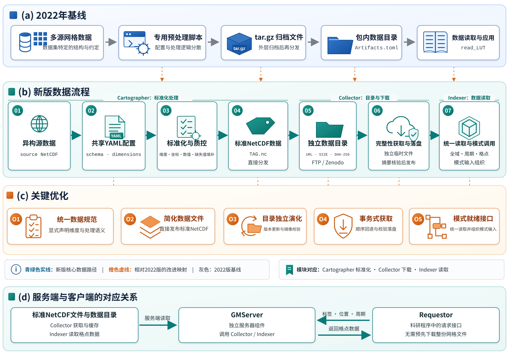
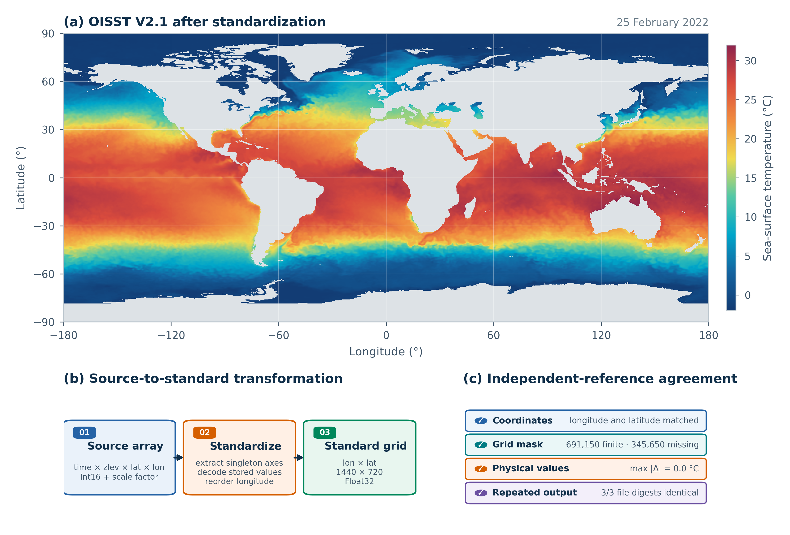
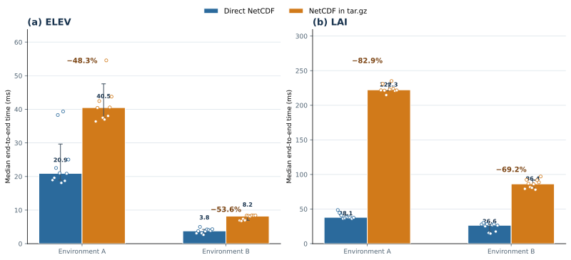

# 面向地球系统模式的全球网格数据库：GriddingMachine框架更新与应用

**姜皓**^1,2　**王玉杰**^1,2,*

^1 中国科学技术大学风云卫星遥感联合实验室，安徽 合肥 230026

^2 崂山实验室，山东 青岛 266237

\* 通讯作者（wyujie@ustc.edu.cn）

## 摘要

地球系统模式依赖区域至全球尺度的网格数据进行参数初始化及结果验证。尽管当前数据大多已采用NetCDF、HDF、GeoTIFF等标准格式，不同数据源在处理规则、单位、数据标识和网络分发方式等方面仍存在差异，研究人员往往需要针对各自模式重复整理和维护数据库，增加了模式持续更新与验证的工作量。本文在2022版GriddingMachine（v0.2）的基础上，围绕数据预处理、分发和读取进行进一步改进。在数据预处理方面，新版GriddingMachine（v0.5）提供了标准化的数据处理流程，以便数据提供方进行数据标准化及验证。在数据分发方面，我们将定期更新的数据库文件上传至Zenodo，以保证每个版本的数据库的可追溯性；同时，我们将NetCDF数据文件上传至Zenodo和ScienceDB上，降低数据的获取难度。在数据读取方面，我们进一步提供了读取多源数据集合的功能，例如一次性获取陆面模式所需的初始化参数和气象驱动，为模式运行提供更便利的输入。新版GriddingMachine实现了数据IO功能（如数据处理和读取）和数据分发（如数据库和数据文件）的分离，使得新数据的更新独立于软件版本。此外，我们还完善了Matlab、Octave、Python和R语言对新版数据的自动下载支持，并新增C和Fortran语言的自动下载支持，以更好地服务地球科学研究与应用。

**关键词：** 地球系统模式；全球网格数据库；数据标准化；NetCDF；数据完整性；模式输入

**A Global Gridded Database for Earth System Models: Advances and Applications of GriddingMachine**

**Hao JIANG**^1,2, **Yujie WANG**^1,2,*

^1 Joint Laboratory of Fengyun Remote Sensing, University of Science and Technology of China, Hefei 230026, Anhui, China

^2 Laoshan Laboratory, Qingdao 266237, Shandong, China

\* Corresponding author (wyujie@ustc.edu.cn)

## Abstract

Earth system models depend on gridded data at regional to global scales for parameter initialization and evaluation of simulation results. Although most datasets use standard formats such as NetCDF, HDF, and GeoTIFF, differences in processing rules, units, data identifiers, and distribution methods still require researchers to organize and maintain databases for individual models, adding to the work of continued model development and evaluation. Building on GriddingMachine v0.2 released in 2022, the updated framework (v0.5) improves data preprocessing, distribution, and reading. A standardized processing workflow enables data providers to prepare and verify their datasets. Regularly updated database catalogs are archived on Zenodo to make each catalog version traceable, while NetCDF data files are shared through Zenodo and ScienceDB to facilitate access. Reading interfaces support collections of data from multiple sources, allowing initialization parameters and meteorological forcing for a land surface model to be obtained in a single call. The updated framework separates data input and output operations, including processing and reading, from the distribution of catalogs and data files, so that new data can be added independently of software releases. Automatic downloading of the updated data has also been improved for Matlab, Octave, Python, and R, with new support for C and Fortran, to better serve Earth science research and applications.

**Keywords:** Earth system models; global gridded database; data standardization; NetCDF; data integrity; model input

## 1 引言

地球系统模式的参数初始化、边界条件设置、气象驱动和结果验证均依赖区域至全球尺度的网格数据。这些数据通常由不同研究团队和业务机构提供，即使其采用相同的文件格式，其坐标排列、空间与时间分辨率、变量含义、单位和缺失值表示仍可能存在差异。为此，研究人员经常需要在获取数据后，进行额外的数据转换和格式处理。此类工作往往随各模式的需求分别开展，且在源数据或模式接口更新后，相应程序和输入文件还需持续维护。因此，减少同类数据的重复整理、在更新中保持数据读取的一致性、降低数据应用的门槛，是数据共享与应用中的亟需解决的问题。

Google Earth Engine通过改善数据表达、发现、访问及计算，提升了大尺度地学数据的访问和分析能力[1]。在将这些数据用于本地地球系统模式时，研究人员仍需根据模式要求统一网格、变量和单位，并在源数据更新后维护处理规则、数据版本与模式输入之间的对应关系。因此，标准化的数据转换规则、清晰的数据标识和自动化的数据获取，是衔接数据共享与本地模式应用的重要基础。Wang等[2]于2022年做了初步尝试，发布了基于Julia语言的GriddingMachine数据库和软件（v0.2）。Wang等[2]首先将常用于地球系统模式的全球网格化数据整理为具有统一空间和变量约定的NetCDF文件，随后为各数据分配唯一且易于识别的数据标签，最后将数据标签与下载地址保存在GriddingMachine.jl软件包内的Artifacts.toml文件中，以便实现数据自动下载。

GriddingMachine项目提供了Julia的数据下载、读取以及在线请求的全功能接口，并提供了Matlab、Octave、Python和R的数据下载接口，为多源数据的统一访问奠定了基础。然而，随着数据类型和应用需求扩展，原有流程在数据维护和模式接入方面仍有改进空间。例如，v0.2版本的数据存储在加州理工学院的FTP服务器上，存在服务关停风险和数据下载带宽限制；Artifacts.toml文件只能通过GriddingMachine版本更新（即便核心代码不变）；标准已压缩的NetCDF文件仍然经外层tar.gz压缩后分发，使用前还需解压，对于大文件非常不友好。此外，获得标准网格数据后，研究人员仍需根据具体模式需求组合参数和气象输入数据，造成不必要的代码重复。针对这些问题，改进应围绕提高数据的安全性、降低数据下载时间成本、软件与数据独立维护、集合数据读取等。

本研究将从数据预处理、分发与读取三个方面更新GriddingMachine，在保证原数据的一致性的同时，降低数据获取的难度。我们同时完善了Matlab、Octave、Python和R语言对新版数据的自动下载支持，并新增了C和Fortran语言的自动下载支持。

## 2 GriddingMachine框架

新版GriddingMachine（v0.5）在原有Collector、Indexer和Requestor模块的基础上，增加Cartographer用于数据标准化处理，并将服务器功能组织为独立的GMServer组件，避免服务器依赖增加数据访问软件的安装与首次运行开销（图1）。Cartographer负责标准化数据及核查处理结果；Collector依据数据目录获取并缓存文件；Indexer读取标准化数据并组织多源数据集合；Requestor向服务器请求指定格点的数据；GMServer在服务端调用Collector和Indexer，将所需数据返回Requestor。GriddingMachine.jl的安装与使用如下：

```text
pkg> add GriddingMachine
julia> using GriddingMachine
```



**图1 GriddingMachine框架更新与模块协作** （a）2022版GriddingMachine（v0.2）的预处理、分发、读取与在线请求方式；（b）新版GriddingMachine（v0.5）的数据预处理、分发和读取三个环节。Cartographer结合源数据与YAML配置生成标准NetCDF文件；数据文件与数据库文件`Artifacts.yaml`分别维护，Collector依据目录获取文件，Indexer读取单文件或多源集合；（c）GMServer在服务端复用Collector和Indexer，Requestor按数据标签、经纬度和周期请求并接收格点数据。2.1—2.7对应正文小节；实线表示数据传递，虚线表示配置、目录或请求信息。

**Fig. 1 Framework updates and module interactions in GriddingMachine.** (a) Preprocessing, distribution, reading, and online requests in GriddingMachine v0.2, released in 2022. (b) Data preprocessing, distribution, and reading in v0.5. Cartographer produces standard NetCDF files from source data and YAML configurations. Data files and the catalog, `Artifacts.yaml`, are maintained separately; Collector retrieves files using the catalog, and Indexer reads individual files or multisource collections. (c) GMServer reuses Collector and Indexer on the server. Requestor sends a data label, coordinates, and a cycle index and receives grid-cell data. Numbers 2.1–2.7 refer to manuscript subsections. Solid arrows represent data transfer; dashed arrows represent configuration, catalog, or request information.

### 2.1 Cartographer：数据标准化处理

Cartographer提供数据标准化及验证功能，以便数据提供方将不同来源的网格数据整理为GriddingMachine采用的标准NetCDF文件。其标准化处理程序由GriddingMachineDatasets实现，数据提供方可使用该程序生成后续获取与读取所需的文件。标准文件沿用既有的规则经纬网与变量约定[2]，以经度、纬度为前两维，可选第三维表示月份等周期；数值保存为实际物理值，缺失值在读取后统一表示为`NaN`，并保留变量说明和单位。标准文件的主要约定见表1。

**表1 GriddingMachine标准NetCDF文件的主要约定**

**Table 1 Main conventions for standard NetCDF files in GriddingMachine.**

| 规范要素 | 统一约定 |
|---|---|
| 文件与网格 | 一个标签对应一个NetCDF文件；采用规则经纬网，默认全球覆盖，并声明坐标参考 |
| 维度顺序 | 二维`(lon, lat)`或三维`(lon, lat, ind)`；`ind`表示月份等周期索引 |
| 坐标方向 | 经度自西向东，范围为`[-180, 180)`；纬度自南向北；坐标与数据逐点对应 |
| 数据与元数据 | `data`为主变量，`std`为可选的同形不确定性变量；保存实际物理值、变量说明和单位 |
| 范围与缺失值 | 按变量有效范围处理数值；未填补的缺失值在读取后统一表示为`NaN` |
| 处理记录 | NetCDF变量属性记录维度、坐标及数值处理的实际变更 |

数据提供方通过YAML文本配置文件指定输入文件、源变量名称、维度含义、单位、有效范围和缺失值处理方式。我们提供了程序化和本地交互式两种配置生成方式，方便数据提供方根据数据特点设置处理规则。新增或更新同类数据时，调整输入文件、变量名称及处理参数，即可复用已有转换程序。对于非规则网格和区域投影数据，先由数据源专用预处理程序完成网格或投影转换，再进入规则经纬网的通用处理流程。

程序读取并检查配置后，首先调整数据的维度顺序和空间方向。例如，源数据按纬度、经度排列，纬度由北向南，经度范围为0°～360°时，程序交换维度、翻转纬度方向并沿经度循环平移，使数据与经度自西向东、纬度自南向北的标准坐标逐点对应。随后按配置中的系数进行线性数值换算，并将超出有效范围的数值标记为缺失。

缺失值填补（gap filling）由配置中的`GAPFILL`字段指定。数据提供方可根据变量的物理含义，选择保留缺失值，或以常数、均值填补陆地区域的缺失值；还可按数据覆盖要求检查陆地区域及全域的缺失情况，并对类别数据进行整数化处理。例如，高程数据（ELEV）采用常数0填补陆地区域缺失值。完整配置与字段说明见补充材料S3。

处理过程中生成带经纬度坐标轴的空间分布图，由数据提供方确认数据的位置和方向。确认后，文件按数据标签命名并保存，实际执行的维度调整、数值换算及缺失值填补等变更写入NetCDF变量属性，配置文件保留相应处理规则。文件保存后，再核查维度和变量是否齐全、数组形状是否一致，以及数值范围和缺失值分布是否符合要求；对于要求陆地区域数据完整的变量，利用相应分辨率的陆地掩膜进行核查。配置规范版本（`SCHEMA_VERSION`）、完整YAML、固定输入及代码环境共同归档，便于重复处理。

配置完成后，可在GriddingMachineDatasets环境中调用标准化程序：

```julia
using GriddingMachineDatasets
# Process source data using the prepared YAML configuration.
process_dataset!("dataset.yml")
```

其中，`dataset.yml`为已设置输入文件及处理规则的配置文件。程序按配置完成数据读取、转换和方向核查，确认后保存标准NetCDF文件。

### 2.2 数据文件共享

为便于研究人员获取和长期使用数据，标准化文件可发布到Zenodo、ScienceDB等科研数据平台，也可由机构服务器提供镜像。公共科研存储有助于减少数据分发对单一机构服务器的依赖；不同位置保存内容一致的文件，则为使用者提供多个获取地址。

标准化数据以单个NetCDF文件作为共享单元，文件名与数据标签对应。2022版GriddingMachine（v0.2）将NetCDF文件经外层`tar.gz`压缩后分发，使用前需要解压；新版GriddingMachine（v0.5）直接分发NetCDF文件，使下载后的文件可以直接用于读取，减少了数据获取与使用之间的处理步骤。

文件通过超文本传输协议（HTTP/HTTPS）或文件传输协议（File Transfer Protocol，FTP）地址提供下载，同一数据标签可登记多个镜像。下载地址和文件完整性信息由数据库文件统一记录。分发位置调整时，数据提供方更新相应记录，科研程序继续通过标签获取数据。

### 2.3 数据库文件

数据库文件是一份记录数据标签、文件位置及相关信息的数据清单。我们将原来保存在软件包内的`Artifacts.toml`改为独立维护的`Artifacts.yaml`，使新增数据或调整下载地址时，不必同时发布访问软件。数据库文件采用YAML文本格式，并通过Zenodo保存不同版本；研究人员可选用相应版本，也可保留试验所用的清单，记录当时选用的数据及分发信息。

每个数据标签对应一个条目，其中本地相对路径（`PATH`）确定文件的保存位置，下载地址（`URL`）列出可用镜像，文件字节数（`SIZE`）和文件摘要（`SHA256`）用于核对下载内容。登记工具根据标准NetCDF文件计算字节数和SHA-256摘要，再将其与下载地址一并写入数据库文件。Collector据此查找和获取文件，Indexer读取相应数据；数据库内容和软件功能因而可以分别更新。

以2020年MODIS叶面积指数数据为例，数据库文件中的记录如下。这里展示其中一个下载地址，多个镜像可依次列在`URL`下：

```yaml
# One download address from the existing LAI catalog entry.
LAI_MODIS_2X_8D_2020_V1:
  PATH: "public/v0"
  SIZE: 13936426
  SHA256: >-
    fda32f694a38d9d3c5244cd5bd739825c7441c918d91e56442a553ab4fa5d0df
  URL:
    - >-
      https://zenodo.org/records/17732092/files/LAI_MODIS_2X_8D_2020_V1.nc
```

标签用于科研程序中的数据调用，`PATH`确定本地保存目录，`URL`提供文件位置，`SIZE`和`SHA256`用于确认获取的文件与登记内容一致。

研究所用目录版本收录1179个数据条目，包括高程与陆地掩膜、土壤水力性质、植被结构与叶片属性，以及气象驱动等数据。地形和土壤属性用于描述格点的基础陆面条件，植被数据包含季节变化信息，逐时气象数据提供模式运行的外部驱动。数据标签记录类别、空间与时间分辨率、年份和版本，并与文件名对应；数据修订时，可在文件名中附加修订号。各条目登记机构FTP地址，部分同时配置Zenodo镜像。目录版本与统计记录见补充材料S7。

### 2.4 Collector：数据自动化下载

Collector依据数据库文件获取数据，并管理本地目录和缓存。程序读取本地`Artifacts.yaml`；文件不存在时，从配置的远端地址获取。研究人员也可指定目录来源，或显式更新本地数据库文件，以使用新增或修订的数据。更新时，程序检查下载内容的结构和字段，通过后替换本地目录文件，并保留上一有效版本。

获取某个数据集时，Collector根据标签查找本地文件及候选下载地址。符合目录记录的已有文件可直接复用；需要下载时，先写入临时文件，依据目录登记的完整性信息核验后，再更新正式文件。当前镜像不可用或内容核验未通过时，继续尝试其余地址，获取失败时保留已有文件。候选镜像可依据访问延迟排序。除单个数据集获取外，Collector还支持选定标签的批量同步和全库同步，使研究人员能够按任务需要维护本地数据。目录字段与调用示例见补充材料S2。

例如，更新数据库文件后，可按上述叶面积指数数据的标签获取文件：

```julia
using GriddingMachine.Collector
# Refresh the catalog and obtain the local NetCDF path.
update_database!()
file_path = download_dataset!("LAI_MODIS_2X_8D_2020_V1")
```

`file_path`为下载或复用的本地NetCDF文件路径，可直接交给Indexer读取。

除Julia的Collector外，新版还完善了Matlab、Octave、Python和R的数据自动下载入口，并新增C和Fortran支持。这些入口采用相同的数据目录约定，由共享的Python下载程序实现，使用时需要Python 3运行环境。科研程序可通过文件URL或本地数据库文件中的数据标签指定所需文件，按一致的镜像与核验规则完成下载，再利用相应语言的NetCDF工具读取。接口调用示例见补充材料S5。

### 2.5 Indexer：数据及数据集读取

Indexer既可读取单个标准化数据文件，也可按预定义集合读取多源数据。单文件读取按标签或路径取得某个变量；集合读取则将科研任务需要的多个数据标签预先组织起来，研究人员按集合名称、年份和位置调用相应接口，即可获得所需的参数集合或气象序列，减少逐项查找和组合数据的工作。

#### 2.5.1 标准网格数据读取

标准网格读取接口`read_dataset`可按本地NetCDF路径或数据标签访问数据，支持读取文件覆盖的全部空间网格、指定周期的空间切片，以及站点的全部周期或指定周期数据，共4种方式。按标签调用时，目录模块自动获取对应文件。接口默认读取标准变量`data`，也可读取文件中可选的原始数据变量`raw_data`或形状相同的不确定性变量`std`。各读取方式采用一致的维度、单位和缺失值约定，便于后续组合模式输入。

以同一叶面积指数数据和北美通量观测站US-NR1的位置为例，4种读取方式分别为：

```julia
using GriddingMachine.Indexer
tag = "LAI_MODIS_2X_8D_2020_V1"
# Read all grid cells and cycles.
data = read_dataset(tag)
# Read the spatial slice for the eighth cycle.
layer = read_dataset(tag, 8)
# Read all cycles at the target grid cell.
series = read_dataset(tag, 40.0329, -105.5464)
# Read the eighth cycle at the target grid cell.
value = read_dataset(tag, 40.0329, -105.5464, 8)
```

上述调用依次返回全部空间与周期数据、第8个周期的空间切片、目标格点的周期序列及该格点第8个周期的数值。示例中的`8`表示周期索引，并非月份；该数据采用8日时间分辨率。

站点读取根据全球规则经纬网的分辨率，将目标经纬度换算为数组索引。输入文件的维度顺序为`(lon,lat[,ind])`，经度自西向东、纬度自南向北排列。接口直接提取对应格点的数据；需要投影转换、非规则网格转换或空间插值时，先由数据源专用预处理程序完成相应处理。周期索引表示月份、日期还是小时，由相应数据的元数据说明。

#### 2.5.2 多源数据集合读取

陆面参数集合将土壤、冠层、叶片、地形、陆地掩膜和植物功能型数据按模式所需字段组织。研究人员指定集合名称、年份和经纬度后，接口按各数据的网格分辨率提取目标格点，并根据陆面状态组合参数。本文采用的第二套陆面参数集合`gm2`包含14类标准化数据，其中冠层聚集度采用月尺度数据。叶面积指数、叶绿素、冠层聚集度和最大羧化速率等季节序列经缺失值处理后统一到逐日时间轴，月尺度数据按各月实际天数展开，8日尺度数据按覆盖日期展开，按年份保留365或366日。

参数组织保留采用C3和C4光合途径的植物在叶片光学参数与Medlyn气孔导度模型参数上的差异[3,4]，并利用叶片羧化与电子传递能力的关联组织光合参数[5]。输出涵盖土壤水力性质、冠层结构、植物功能型组成及叶片生物物理和光合参数，并检查字段完整性与缺失值分布。具体换算与模式适配见第3.4节和补充材料S1。

气象驱动集合`wd1`包含8类第五代全球再分析数据（ERA5）[6]，包括地表气压、降水、辐射、气温、水汽压亏缺和风速。接口按位置和年份提取对应格点的逐小时序列，也可从已加载的全域气象数组中索引数据，并以浮点年积日（fractional day of year，`FDOY`）组织时间轴。时间标记按小时中点和位置经度转换为地方平太阳时，与Emerald的太阳天顶角计算对应。

上述两类集合分别提供模式参数和气象驱动。集合读取在单变量提取之外统一处理字段组合和时间组织，科研程序因而可以复用同一套数据准备方法。本文以Emerald为例，将集合输出按其字段和单位要求接入初始化与驱动接口；其他模式可依据自身输入约定进行适配。

在上述站点位置，2020年的陆面参数与气象驱动可分别通过以下调用获得：

```julia
using GriddingMachine.Indexer
# Assemble the land parameter collection at the target grid cell.
land = grid_dict("gm2", 2020, 40.0329, -105.5464)
# Organize the hourly meteorological forcing at the same grid cell.
forcing = grid_weather("wd1", 2020, 40.0329, -105.5464)
```

`land`按字段保存陆面参数，`forcing`组织气象序列及相应时间信息。科研程序可据此提取模式所需字段，无需逐项查找和读取组成集合的数据。

### 2.6 GMServer：数据服务器搭建

GMServer用于搭建网格数据查询服务，便于研究人员通过网络获取指定位置的数据。新版将服务器组织为独立组件，单独加载Genie网络服务框架所需依赖，减少服务器功能对本地数据访问软件安装及首次运行的影响。服务提供方配置数据根目录和数据库文件来源，注册查询接口后启动服务；科研客户端随后通过服务器地址发送查询。

在独立的服务器项目环境中，加载GriddingMachineServer后即可注册查询接口并启动服务：

```julia
using GriddingMachineServer
# Register query routes and start the server on port 5055.
setup_url_input_routes!()
up_servers!(5055)
```

上述调用在5055端口提供查询服务，同机客户端可通过`http://localhost:5055`访问；其他客户端使用部署机器的相应地址。

服务端复用Collector和Indexer，按照请求中的标签、经纬度和周期获取或复用本地文件，再提取相应格点的数据。除单数据集查询外，服务端还提供按集合名称、年份和位置组织陆面参数或气象驱动的查询接口。结果采用便于程序解析的JSON（JavaScript Object Notation）文本格式返回，单数据集查询可同时返回文件中可用的不确定性数据。

GMServer还提供查询页面，便于使用者选择数据、输入位置和周期并查看结果。数据文件由服务端统一获取和缓存，多个查询可复用已有文件，客户端接收本次查询所需的数据。

### 2.7 Requestor：非下载式数据请求

Requestor沿用GriddingMachine按格点在线获取数据的方式，与独立GMServer配合，使科研程序无需预先下载完整网格文件。调用时提供服务器地址、数据标签、目标经纬度和周期，服务器完成数据获取及格点读取后，将结果返回请求端。文件存储和读取发生在服务端，请求端接收所需数值，以便继续开展站点分析或模式计算。

现有请求接口支持单数据集指定格点的全部周期或某个周期，并接收主变量及可用的不确定性数据。Requestor解析服务器返回的JSON文本，将传输时使用的缺失值标记还原为`NaN`，以便后续计算。需要重复使用完整文件时，可通过Collector下载后本地读取；仅需指定位置的数据时，可采用Requestor请求。两种方式使用相同的数据标签和格点读取规则。

例如，在同一机器启动上述服务后，可请求同一叶面积指数数据在US-NR1附近格点的周期序列：

```julia
using GriddingMachine.Requestor
server = "http://localhost:5055"
tag = "LAI_MODIS_2X_8D_2020_V1"
# Request all cycles and the available uncertainty at the target grid cell.
series, uncertainty = request_site_data(
    server, "research", tag, 40.0329, -105.5464)
```

其中，`research`为请求记录中的使用者标记；`series`返回目标格点的周期序列，`uncertainty`返回文件中可用的不确定性数据，无该变量时为`nothing`。

以上功能将数据标准化、文件共享、目录维护和科研程序中的数据访问连接起来。数据提供方维护处理规则及标准文件，科研程序通过标签获取数据，或向服务端请求所需格点；新增数据、调整分发位置与维护访问软件因此可以分别进行。表2按上述功能环节归纳2022版GriddingMachine（v0.2）与新版GriddingMachine（v0.5）的主要差异。

**表2 GriddingMachine v0.2与v0.5的主要功能比较**

**Table 2 Comparison of the main functions of GriddingMachine v0.2 and v0.5.**

| 功能环节 | v0.2 | v0.5 |
|---|---|---|
| 数据标准化 | 数据源专用脚本与贡献流程 | 共享YAML配置与通用处理流程，支持配置生成及结果核查 |
| 数据文件共享 | 机构FTP分发；NetCDF外层`tar.gz`归档 | Zenodo、ScienceDB及机构镜像共享；直接分发NetCDF |
| 数据库文件 | Julia包内置`Artifacts.toml` | 独立维护`Artifacts.yaml`，数据目录与软件分别更新 |
| 数据自动获取 | 多URL下载、哈希核验及解包 | 多镜像回退，临时文件核验后更新正式文件 |
| 多语言下载 | 提供Matlab、Octave、Python和R下载接口 | 完善原有接口，新增C和Fortran；支持URL或标签下载与完整性核验 |
| 单文件读取 | `read_LUT`读取全域网格、周期切片及格点数据 | `read_dataset`按路径或标签读取，保留`read_LUT`兼容调用 |
| 多源数据集合读取 | 通用网格读取，模式输入由使用者组织 | 按集合名称、年份和位置组织陆面参数与气象驱动 |
| 在线格点访问 | Requestor按格点请求服务器数据 | 保留格点请求；独立GMServer在服务端复用Collector和Indexer |

## 3 应用案例与评价方法

应用案例分别考察数据标准化、分发和模式接入中的改进效果。受控处理实例与真实最优插值海表温度数据（Optimum Interpolation Sea Surface Temperature，OISST）用于检验统一流程对维度、坐标和数值差异的处理；ELEV与叶面积指数数据（Leaf Area Index，LAI）用于比较有无外层归档时的数据获取和首次读取时间，网络镜像实验进一步核对不同地址所提供文件的一致性。北美通量观测站US-NR1附近格点的陆面参数与气象驱动用于考察多源数据能否形成模式输入，并通过跨操作系统测试检查核心流程的运行一致性。各案例与评价指标见表3。

**表3 GriddingMachine框架更新的应用案例与评价指标**

**Table 3 Application cases and evaluation metrics for the GriddingMachine framework updates.**

| 评价内容 | 实验数据与对照 | 主要评价指标 |
|---|---|---|
| 标准化与重复处理 | 31组受控处理及构造参考；配置生成与贡献流程；ELEV重复处理3次；OISST V2.1独立解码对照 | 维度、坐标、有效值掩膜与逐点数值；重复生成摘要；登记与获取结果 |
| 文件分发效率 | ELEV与LAI；Windows和macOS回环HTTP；直接NetCDF与外层`tar.gz`对照 | 端到端时间、传输字节与文件存储占用 |
| 目录更新与镜像获取 | 13类镜像状态及目录更新；Zenodo公共网络与中国科学技术大学（以下简称中科大）校内网FTP—Zenodo同文件获取；ERA5降水单位修订及原标签访问 | 候选镜像选择；文件大小与SHA-256；临时及正式文件状态；修订后标签访问与缓存复用 |
| 模式输入组织 | 参考数据核对；US-NR1的14类陆面数据与8类ERA5逐时数据；非植被格点；底层读取对照及Emerald初始化、60 s首步 | 字段与形状、时间轴、量纲与逐点数值；初始化与首步状态 |
| 跨操作系统运行与多语言下载 | Windows、macOS和Linux持续集成，Windows/macOS独立环境；Matlab、Octave、Python、R、C和Fortran的URL与标签下载 | 数据结构、逐点数值与文件摘要；接口状态、镜像回退、错误返回与缓存保留 |


### 3.1 数据生产与标准化及OISST案例

#### 3.1.1 共享处理规范与质量控制

为检验YAML驱动流程能否正确处理多维网格数据，本文构造以空间位置编码的参考数组：二维数组的值由经纬度索引共同确定，三维数组进一步加入周期索引。数组值与位置之间的对应关系已知，因此可逐点核对维度交换、方向翻转、经度平移和周期组织后的结果。

处理实例按评价目标分为结构转换、数值处理以及配置一致性与流程复用三类。结构转换比较`(lon,lat)`与`(lon,lat,ind)`标准输入、`(lat,lon)`与`(ind,lat,lon)`源排列，以及坐标翻转和`0～360°`经度平移后的逐点对应关系。数值处理依据设定规则核对线性缩放、范围过滤和缺失值填补结果。配置一致性与流程复用则核对字段与变量数量、`data/std`的保存结果，以及已有数据集与标签的状态，确认配置生成、重复执行与目录登记是否遵循同一约定。

围绕上述评价目标设计31组处理实例，其中29组非交互实例在Windows、macOS和Linux持续集成环境中采用相同判据运行；空间方向测试V01和V02分别呈现正确方向和南北反转，用于核对方向控制。完整分类矩阵见补充材料S4。

配置构建器分别以二维数据、含不确定性变量的三维数据和经纬度变换数据为输入，生成YAML并执行标准化，再将输出与参考数组比较。数据贡献案例进一步覆盖配置生成、自动与人工质量检查、发布、目录登记，以及下游目录更新、下载和读取，以检验处理结果能否在各环节间连续使用。

ELEV重复处理案例以已有标准NetCDF为输入，先比较统一读取与底层NetCDF读取所得的数组和坐标，再采用显式标准维度、`KEEP_AS_IS`及不执行缩放和范围裁剪的配置连续处理3次。比较各次输出的`data/lon/lat`与输入，并核对输出文件的SHA-256，以检验重复处理是否保持数据值和空间结构。

#### 3.1.2 OISST异构数据集标准化

OISST案例用于检验共享配置对真实异构源数据的适配。采用美国国家海洋和大气管理局国家环境信息中心（NOAA/NCEI）发布的0.25°逐日OISST V2.1数据，选用仅使用甚高分辨率辐射计（AVHRR）数据的版本[7]，选取2022年2月25日文件。原始`sst`变量在NetCDF中声明为`time×zlev×lat×lon`，其中`zlev`和`time`均为单例维度；Julia读取后的数组顺序为`lon×lat×zlev×time`，形状为1440×720×1×1。经度覆盖0.125°～359.875°，存储类型为Int16，并以0.01缩放因子解码为摄氏度。

数据源专用预处理模块提取唯一的垂向层和时间层，共享YAML配置进一步完成维度声明、`0°～360°`至`[−180°, 180°)`的经度重排、有效范围控制和缺失值策略，生成`SST_OISST_4X_1D_20220225_V1`标准化数据。

独立参考流程直接读取未缩放的Int16存储值，根据原始NetCDF中的缩放因子`scale_factor`、偏移量`add_offset`和填充值`_FillValue`计算物理值与缺失值掩膜，并独立计算目标经度索引。参考结果记录全域统计量、10个确定性有效格点和10个缺失格点。标准化数据连续生成3次，逐点比较坐标、有效值掩膜和物理值。随后根据标准NetCDF文件建立包含逻辑路径、镜像地址、字节数和SHA-256的目录条目，通过回环HTTP执行事务式下载，再由统一读取接口完成全域网格逐点核对。

### 3.2 ELEV与LAI的直接NetCDF分发效率评价

分发效率比较采用二维静态高程数据集`ELEV_4X_1Y_V1`和三维8日尺度叶面积指数数据集`LAI_MODIS_2X_8D_2020_V1`，代表不同规模和维度的内部压缩数据。每个标准NetCDF分别以原始`.nc`文件和包含同一文件的`tar.gz`归档分发，对照归档采用gzip级别6。直接分发的NetCDF与归档解包后的文件具有相同SHA-256，因此可在内容一致的条件下比较外层打包与解包所增加的时间和存储占用。

性能分析在Windows（环境A）和macOS（环境B）中采用回环HTTP服务。每个“数据×分发形式”组合经过缓存预热后按随机顺序测量10次，记录传输字节数、打包与解包时间、从请求开始到首次读取NetCDF值的端到端时间，以及获取过程中的文件存储占用（下载文件与解包文件并存时的合计大小）。两个独立环境使用一致的脚本和输入文件，时间指标以中位数、四分位距和95% Bootstrap置信区间表示。

### 3.3 多镜像获取与内容完整性

目录管理实验考察数据修订后能否按原标签获取对应文件，以及获取异常时能否保留已有有效文件、重复获取时能否保持内容一致。实验使用不同版本的Artifacts.yaml、多个NetCDF文件和两个镜像端点，在目录更新与重复调用后比较获取结果、文件摘要和缓存状态，并与小型参考目录的预设结果核对。目录首次建立、全库同步、历史整理和状态查询等操作及其文件状态记录见补充材料S2与S6。

多镜像分析在两个独立环境中构建内容一致、访问状态可配置的镜像集合，通过延迟分数组织候选顺序，并以13类受控状态场景检验镜像回退、缓存复用、内容核验和正式文件状态。每类场景在各环境中重复5次，记录候选选择、获取结果和文件状态；另在中科大校内网分别从机构FTP与Zenodo公共存储获取文件，考察两类镜像的分发特点和内容一致性。完整场景矩阵列于补充材料S6。

镜像访问实验选取4个同时具有FTP和Zenodo地址且已登记`SIZE`与`SHA256`字段的代表性标签，对各文件—镜像组合开展重复下载，记录候选顺序、传输时间、字节数和SHA-256。公共网络场景考察Zenodo的文件获取情况；中科大校内网场景比较FTP与Zenodo提供的同一文件，共形成24次完整性记录。实验数据与环境信息随可复现材料归档。

### 3.4 统一读取与模式输入组织

模式输入案例考察标准网格数据经过陆面参数融合和气象驱动组织后，能否用于Emerald初始化。首先利用确定性参考数据核对字段名、形状、类型、时间索引和缺失值处理，再采用2020年第二套陆面参数集合，分别为US-NR1研究站点附近的植被格点和典型非植被格点生成输入，检查不同陆面状态下的参数组织。

叶片光学参数与Medlyn气孔导度模型参数分别按采用C3和C4光合途径的植物组织[3,4]。C3参数按格点内对应植物功能型的比例归一化加权，C4参数从相应类型的参数表提取，以保留两类植物的参数差异。叶片羧化能力与电子传递能力的关联为光合参数组织提供依据[5]。本研究采用GriddingMachine模式输入接口的固定比例参数化，根据25 ℃下最大羧化速率`VCMAX25`计算最大电子传递速率`JMAX25`和细胞色素b6f复合体含量`B6F`，换算关系、参数单位与实现出处见补充材料S1。输出包括位置、分辨率、年份、二氧化碳（CO₂）、土壤水力性质、冠层结构、植物功能型组成、叶片生物物理和光合参数，同时检查字段是否完整以及缺失值标记`NaN`的分布。经过上述处理，多源数据形成结构一致的格点级模式输入。

真实气象案例使用同一年度的8类ERA5标准化数据[6]：地表气压、降水、漫射与直射短波辐射、长波辐射、气温、水汽压亏缺和风速。八文件从中科大机构FTP获取，并逐文件记录SHA-256。US-NR1坐标（40.0329°N、105.5464°W）由规则索引映射到40.5°N、105.5°W格点；2020年为闰年，预期每个字段包含8784个逐小时值。实验同时核对8个`data`变量的`lon×lat×ind`维度、360×180×8784形状及单位属性。模式输入组织层输出与底层NetCDF直接读取的同一格点序列逐点比较。

时间轴按接口约定，以协调世界时（Coordinated Universal Time，UTC）年度序列的小时中点作为时间标记，并按经度除以15得到的小时偏移转换为地方平太阳时。经纬度调用采用输入位置的经度，数组索引调用采用格点中心经度；完整公式见补充材料S1。本案例按输入站点经度−105.5464°计算偏移并独立重建`FDOY`，分别记录数据取样位置与时间计算位置。随后把真实陆面参数和真实气象驱动共同传入Emerald，检查初始化和60 s首步后的大气、土壤状态是否均为有限值。

### 3.5 跨操作系统运行一致性与多语言下载评价

跨操作系统测试采用一致的项目依赖、参考数据和判据，比较核心流程的数据结构、逐点数值、文件摘要及接口状态。Windows和macOS本地环境开展生产、分发效率、镜像状态和模式接口测试，Windows、macOS和Linux持续集成环境运行非交互处理与确定性核心流程。各系统的测试项目及真实网络、US-NR1案例的运行环境见补充材料S5。

多语言下载评价考察Matlab、Octave、Python、R、C和Fortran科研程序能否按相同约定获取数据。在相应语言运行环境中，通过文件URL和数据标签获取回环HTTP提供的确定性参考文件，并核对文件字节数、SHA-256与二进制内容；首选镜像不可用、文件大小或摘要不符的情形用于检验镜像回退、错误返回和已有文件保留。含空格与特殊字符的路径及不同工作目录用于检查参数传递和接口调用。各语言环境、调用示例与结果记录见补充材料S5。

## 4 结果

按照表3所列评价设计，以下依次呈现标准化数据生产、直接NetCDF分发效率、多镜像获取、模式输入组织和跨操作系统运行一致性结果。

### 4.1 数据生产与标准化及OISST结果

#### 4.1.1 共享处理规范与质量控制结果

共享配置能够指导通用程序处理源数据在维度、坐标和数值上的差异。31组受控处理实例中，29组非交互实例在三系统持续集成中获得一致的数据结构和逐点数值，V01和V02的人工方向检查结果与预设一致。维度重排、坐标翻转、经度平移、数值转换及缺失值处理均得到相应参考结果。数据贡献案例经过配置生成、标准化、目录登记和下游读取后，所得数组仍与参考数组逐点一致，标准化结果在后续获取与读取过程中得到保持。

ELEV在重复处理后保持原有数据值与坐标。1440×720网格全域有效，有限值范围为−415.5～5 357.7002 m，统一读取结果与底层NetCDF的Float32数组逐点一致。按第3.1.1节的原值保持配置连续处理3次，各次输出的`data/lon/lat`均与输入一致，文件SHA-256也彼此相同。这说明通用流程能够接收已有标准化数据，在未要求数值变换时保持其空间结构与数据值。

#### 4.1.2 OISST异构数据集标准化结果

OISST标准化结果的坐标、有效值掩膜和物理值均与独立参考逐点一致（图2）。输出为1440×720规则网格，经度由−179.875°递增至179.875°，纬度由−89.875°递增至89.875°；691 150个有效格点和345 650个缺失格点与参考掩膜一致。海表温度范围为−1.80～32.39 ℃，有效海洋格点的平均海表温度为14.013 ℃，物理值最大绝对差为0。经度重排改变了数组中的位置顺序，但保留了各位置对应的温度与缺失状态。

3次生成的OISST数据值、坐标和文件SHA-256保持一致。标准文件为997 006字节，经目录登记和回环HTTP获取后，字节数与SHA-256均与记录相符，统一读取结果也与独立参考逐点一致。这表明标准化后的数据在登记、下载和读取过程中保持不变，可由下游程序按同一标签重复获取和使用。



**图2 OISST V2.1数据集标准化结果** （a）2022年2月25日全球海表温度标准化数据；（b）从四维源结构、存储值解码和经度重排到二维标准网格的转换路径；（c）坐标、有效值掩膜、物理值及重复生成摘要的独立参考核对。标准化数据为1440×720规则网格，691 150个有效格点及345 650个缺失格点与独立参考掩膜逐点一致，物理值最大绝对差为0，3次生成的文件摘要相同。

**Fig. 2 Standardization results for the OISST V2.1 dataset.** (a) Global standardized sea-surface temperature on 25 February 2022; (b) the transformation from the four-dimensional source layout through stored-value decoding and longitude reordering to the two-dimensional standard grid; and (c) independent-reference checks of coordinates, the finite-value mask, physical values, and repeated file digests. The 1440 × 720 dataset contains 691,150 finite and 345,650 missing cells that match the independently decoded reference mask point by point, with a maximum absolute physical-value difference of zero and identical file digests across three runs.

### 4.2 ELEV与LAI的直接NetCDF分发效率

按照第3.2节的相同输入和测量协议，环境A中直接NetCDF相对外层`tar.gz`将ELEV和LAI的端到端中位时间分别由40.503和222.297 ms降至20.929和38.100 ms，降幅为48.3%和82.9%；环境B中的相应降幅分别为53.6%和69.2%（图3）。两个数据文件的传输字节分别增加6.43%和2.16%，文件存储占用分别减少约48%和49%。80次SHA-256摘要核验结果一致。

两文件均已采用NetCDF内部zlib压缩级别4，对照归档采用gzip级别6。在所测文件和缓存预热条件下，直接NetCDF以较小的传输字节增量减少了解包时间和文件存储占用，缩短了从请求到首次读取数据的路径。



**图3 ELEV和LAI数据集采用直接NetCDF与外层tar.gz分发的端到端时间比较** （a）二维高程数据集ELEV；（b）三维叶面积指数数据集LAI。空心圆表示各组合的10次独立测量，柱高为缓存预热后端到端时间中位数，误差线为95% Bootstrap置信区间；环境A（Windows）和环境B（macOS）采用相同输入文件与测量协议。柱上百分比表示直接NetCDF相对于外层`tar.gz`归档的中位时间降幅。

**Fig. 3 End-to-end distribution time for the ELEV and LAI datasets using direct NetCDF and external `tar.gz` archives.** (a) The two-dimensional ELEV dataset; (b) the three-dimensional LAI dataset. Open circles show the 10 measurements for each combination, bars show median warm-cache end-to-end time, and error bars show 95% bootstrap confidence intervals. Environment A (Windows) and environment B (macOS) used identical input files and measurement protocols. Percentages above the bars indicate the reduction in median time achieved by direct NetCDF relative to external `tar.gz` archives.

### 4.3 目录管理与事务式多镜像分发

镜像切换和获取异常时，下载流程能够保留已有有效文件。13类受控状态场景在两个独立操作系统环境中各重复5次，镜像回退、缓存复用和内容核验结果均符合预设。首选镜像无法访问或未通过内容核验时，程序继续尝试后续镜像；下载失败时，已有正式文件的摘要保持不变。本地有效缓存由此可以继续使用。

公共网络场景中，两个独立环境分别对4个Zenodo标签重复获取3次，共24次下载均与登记字节数和SHA-256一致。下载时间随文件规模呈梯度变化，公共镜像能够向本地科研程序提供内容可核验的数据文件。

中科大校内网场景中，4个数据集分别从FTP和Zenodo重复获取3次，两类镜像各形成12次下载，共24次结果。两类镜像提供的同一数据集均与目录登记的字节数和SHA-256一致，说明机构镜像与公共镜像能够提供内容一致的分发副本。延迟辅助排序与本组实际传输顺序一致；分数据集传输时间与网络记录列于补充材料。

在ERA5降水单位属性由`mm`修订为`m`的案例中，独立目录将原逻辑标签`PPT_ERA5_1X_1H_2020_V1`指向`V1_R1.nc`，记录修订后的字节数与SHA-256，同时分别保留原V1和R1文件。首次调用获取修订文件并通过完整性核验，后续调用则复用本地缓存。科研程序因此可沿用原标签访问修订数据，而各次试验实际使用的文件可由目录版本与摘要追溯。单位修订依据及模式换算见第4.4节。

### 4.4 统一读取与模式输入组织

不同空间分辨率和时间尺度的14类陆面数据经统一组织，形成2020年US-NR1格点的34个模式字段，包含366日季节序列、4个土壤层和17个植物功能型。站点索引映射至40.5°N、105.5°W，高程、陆地掩膜与叶面积指数的读取结果一致。撒哈拉案例被识别为非植被格点，并按相应陆面状态组织参数，说明同一数据集合能够根据格点状态提供植被与非植被条件下的模式输入。各输入文件的大小、来源摘要和SHA-256均通过核验。

8类ERA5气象变量经统一读取，形成US-NR1格点2020年连续的年度逐小时序列。各源变量均为360×180×8784的经度、纬度和逐小时数组，并带有单位属性；站点的每类变量均得到8784个逐小时值，有限值比例为100%，与底层NetCDF读取结果的最大绝对差为0。地方平太阳时偏移为−7.0364 h，浮点年积日严格递增且与独立公式逐点一致。时间轴和8类气象变量共9个字段经Emerald接口适配后，组成16个模式驱动字段，完成从格点年度序列到模式所需变量的转换。逐文件大小与字段信息见补充材料S1。

依据ERA5逐小时总降水的变量定义[8]，降水输入表示每小时累计的米制水层，标准NetCDF单位属性据此修订为`m`，数据值保持不变。US-NR1年度累计降水为0.496409 m，即496.409 mm，用于核对数值尺度与量纲。Emerald按水层厚度、水密度、水的摩尔质量及3600 s累计时段换算为摩尔通量，使数据单位与模式输入一致。完成参数组织、时间轴构建和量纲换算后，将真实陆面参数与气象驱动共同用于Emerald初始化和60 s首步计算，大气与土壤关键状态均保持有限值。该年度案例表明，多源标准网格数据能够按明确的空间、时间与单位关系形成可用的模式输入。

### 4.5 跨操作系统运行一致性与多语言下载结果

跨操作系统运行中，GriddingMachine和GriddingMachineDatasets的确定性核心流程得到一致的数据结构、逐点数值和文件摘要，Emerald合成输入接口的状态均符合预设结果。不同系统能够沿用同一数据约定完成标准化、获取和模式输入组织，为科研程序在不同运行环境中使用这些数据提供支持；各系统测试项目与结果见补充材料S5。

Matlab、Octave、Python、R、C和Fortran接口通过URL或数据标签获取的文件均与参考内容一致。按标签下载时，首选镜像不可用后能够继续尝试其余镜像；文件大小或摘要不符时，接口返回错误并保留已有文件。这些结果表明，不同语言的科研程序可以共用数据目录和核验规则，自动获取标准化网格数据，无需分别编写下载与内容核验程序。

## 5 讨论

### 5.1 相对v0.2版的更新与科研用途

v0.2版GriddingMachine通过统一网格、变量和标签提供多源数据访问[2]，本研究进一步关注数据持续更新中的重复维护。31组处理实例与OISST结果表明，源数据在维度、坐标和数值上的差异可由配置描述，并由通用程序处理；ELEV重复处理结果则表明，已有标准化数据经过同一流程后仍可保持原值。将处理规则与数据文件一同维护，使新增或更新数据能够复用已有转换程序。镜像调整或文件修订后，可单独更新目录中的分发信息，模式程序继续按标签访问数据。

数据库需要持续更新，既有试验也需要能够复现。ERA5降水修订案例说明，更新目录即可使已有标签指向修订文件；保存各次试验使用的目录、文件摘要、处理配置和代码版本，则能确定当时使用的数据及其转换过程。标签便于程序持续调用，归档记录保留具体试验的输入，两者共同支持数据更新和试验复现。

### 5.2 分发效率与科学数据质量

ELEV和LAI已经使用NetCDF内部压缩，外层归档带来的额外压缩收益较小，却增加了解包时间，以及归档文件与NetCDF文件同时保存时的存储占用。两个环境中的对照结果表明，直接NetCDF分发仅增加少量传输字节，即可缩短端到端时间并减少获取过程中的存储需求。对于一个标签对应一个文件的数据库，下载完成后即可读取，省去了科研调用前的解包操作。

数据质量检查关注维度、坐标、物理值、单位和缺失值处理是否符合约定，下载完整性核验则确认收到的文件是否与目录记录一致。OISST的独立解码比较和ERA5降水单位修订体现了数值与量纲检查的作用，受控镜像场景和真实网络下载记录则支持对获取内容的核验。两类检查结合后，既能追溯数据如何从源文件转换而来，也能确认科研程序实际读取了哪个文件。

### 5.3 从标准网格数据到模式输入

US-NR1案例表明，统一文件格式之后的关键工作是建立变量之间的空间、时间和物理联系。不同分辨率的陆面数据按各自网格提取目标位置的参数，季节参数与ERA5逐时气象按共同年度组织，再由模式适配完成字段和量纲转换。降水等累计量还需结合单位和累计时段换算为模式所需通量，使数据的物理含义与模式计算相衔接。将这些关系纳入统一的数据组织方法，能够减少各模式单独整理参数和气象输入的工作。

其他站点和年份可沿用上述读取与数据组织方法；接入不同模式时，可按其空间、时间和变量约定调整配置与适配接口。Julia接口用于组织模式输入，非Julia接口用于在已有科研程序中自动获取文件，研究人员可根据所用语言和计算任务选择调用方式。

### 5.4 与相关数据基础设施的关系及扩展方向

Google Earth Engine提供云端遥感数据访问与计算[1]，GriddingMachine则将共享数据按统一约定保存为可在本地使用的文件，并提供标签下载和格点读取。地球系统数据立方体强调多变量时空数据的联合组织与分析[9]；本文的集合读取面向模式所需参数与气象序列的组合。OISST案例展示源数据标准化，US-NR1案例展示参数与气象序列的集合读取及模式适配。Julia实现便于在科研程序中组合这些处理和读取方法[10]。

数据清单与访问软件分别维护，是这些功能能够持续使用的基础。国内地球系统科学数据共享研究强调规范分类和目录建设[11]；Pooch和STAC分别提供科研文件获取工具与地理空间目录描述规范[12,13]。GriddingMachine在数据标签对应的条目中记录文件位置与内容信息，并将目录单独归档，使新增数据、调整镜像和修订文件不必伴随软件发布。科研程序继续按标签访问，试验所用的目录版本和文件摘要则保留具体输入的记录。

持续更新还需要保存数据出处、处理配置和软件版本，以便识别所用方法并追溯处理结果[14,15]。在此基础上，后续可继续完善公共镜像、扩展数据源配置及模式所需集合，使研究人员沿用已有读取方式开展新的数据分析和模式试验。

## 6 结论

本文针对多源网格数据在转换、分发和模式接入中需要重复整理与维护的问题，更新了v0.2版GriddingMachine。新版通过共享配置记录源数据处理规则，利用独立目录维护标签、分发地址和文件完整性信息，并通过集合读取将多源数据组织为陆面参数与气象驱动。数据处理和读取由软件承担，数据库文件与标准化数据文件单独发布和维护，使新增或修订数据不必伴随软件版本更新。同时完善Matlab、Octave、Python和R对新版数据的自动下载支持，新增C和Fortran支持，使不同编程环境能够通过URL或数据标签获取标准化文件。

受控实例和真实数据案例表明，标准化结果的坐标与物理值均与独立参考一致。直接NetCDF分发减少了解包时间和文件存储占用，缩短了获取至首次读取的时间。FTP—Zenodo镜像所提供的文件与目录登记的摘要一致，数据修订后仍可沿用原标签获取。陆面参数与ERA5逐时数据经组合形成US-NR1模式输入，并完成Emerald初始化和60 s首步计算。

更新后的GriddingMachine使研究人员能够复用已整理的数据及其处理规则，减少不同地球系统模式重复整理和维护数据的工作，为全球网格数据库的持续更新和模式试验提供一致的数据基础。后续将继续扩展数据覆盖范围、完善公共镜像登记，并适配更多模式接口。

## 数据和代码可用性声明

GriddingMachine.jl源代码公开于https://github.com/CliMA/GriddingMachine.jl，数据生产代码公开于https://github.com/jhOo1/GriddingMachineDatasets，Emerald模式接口环境公开于https://github.com/jhOo1/Emerald-paper，论文补充材料、实验协议、脚本和结果公开于https://github.com/jhOo1/GriddingMachine_Reaserach。研究所用代码版本、多语言下载入口及验证记录、数据修订信息和实验结果索引见补充材料S8，精确提交与稿件冻结信息由`论文/投稿版本锁定.toml`统一记录。永久归档与DOI信息随最终归档版本同步发布。

## 作者贡献

姜皓：概念设计、方法设计、软件、数据整理、初稿撰写。王玉杰：概念设计、软件、数据整理、研究指导、项目管理、论文审阅与修改。

## 参考文献

[1] GORELICK N, HANCHER M, DIXON M, et al. Google Earth Engine: Planetary-scale geospatial analysis for everyone[J]. Remote Sensing of Environment, 2017, 202: 18-27. DOI: 10.1016/j.rse.2017.06.031.

[2] WANG Y, KÖHLER P, BRAGHIERE R K, et al. GriddingMachine, a database and software for Earth system modeling at global and regional scales[J]. Scientific Data, 2022, 9: 258. DOI: 10.1038/s41597-022-01346-x.

[3] MEDLYN B E, DUURSMA R A, EAMUS D, et al. Reconciling the optimal and empirical approaches to modelling stomatal conductance[J]. Global Change Biology, 2011, 17(6): 2134-2144. DOI: 10.1111/j.1365-2486.2010.02375.x.

[4] LIN Y S, MEDLYN B E, DUURSMA R A, et al. Optimal stomatal behaviour around the world[J]. Nature Climate Change, 2015, 5: 459-464. DOI: 10.1038/nclimate2550.

[5] WALKER A P, BECKERMAN A P, GU L, et al. The relationship of leaf photosynthetic traits—Vcmax and Jmax—to leaf nitrogen, leaf phosphorus, and specific leaf area: A meta-analysis and modeling study[J]. Ecology and Evolution, 2014, 4(16): 3218-3235. DOI: 10.1002/ece3.1173.

[6] HERSBACH H, BELL B, BERRISFORD P, et al. The ERA5 global reanalysis[J]. Quarterly Journal of the Royal Meteorological Society, 2020, 146(730): 1999-2049. DOI: 10.1002/qj.3803.

[7] HUANG B, LIU C, BANZON V, et al. Improvements of the Daily Optimum Interpolation Sea Surface Temperature (DOISST) Version 2.1[J]. Journal of Climate, 2021, 34(8): 2923-2939. DOI: 10.1175/JCLI-D-20-0166.1.

[8] COPERNICUS CLIMATE CHANGE SERVICE. Conversion table for accumulated variables (total precipitation/fluxes)[EB/OL]. [2026-09-26]. https://confluence.ecmwf.int/pages/viewpage.action?pageId=197702790.

[9] MAHECHA M D, GANS F, BRANDT G, et al. Earth system data cubes unravel global multivariate dynamics[J]. Earth System Dynamics, 2020, 11: 201-234. DOI: 10.5194/esd-11-201-2020.

[10] BEZANSON J, EDELMAN A, KARPINSKI S, et al. Julia: A fresh approach to numerical computing[J]. SIAM Review, 2017, 59(1): 65-98. DOI: 10.1137/141000671.

[11] 王卷乐, 林海, 冉盈盈, 等. 面向数据共享的地球系统科学数据分类探讨[J]. 地球科学进展, 2014, 29(2): 265-274. DOI: 10.11867/j.issn.1001-8166.2014.02.0265. [WANG Juanle, LIN Hai, RAN Yingying, et al. A study of Earth System Science data classification for data sharing[J]. Advances in Earth Science, 2014, 29(2): 265-274.]

[12] UIEDA L, SOLER S R, RAMPIN R, et al. Pooch: A friend to fetch your data files[J]. Journal of Open Source Software, 2020, 5(45): 1943. DOI: 10.21105/joss.01943.

[13] OPEN GEOSPATIAL CONSORTIUM. SpatioTemporal Asset Catalog (STAC) Community Standard, Version 1.1.0[S/OL]. OGC 25-004, 2025 [2026-09-26]. https://www.ogc.org/standards/stac/.

[14] SMITH A M, KATZ D S, NIEMEYER K E, et al. Software citation principles[J]. PeerJ Computer Science, 2016, 2: e86. DOI: 10.7717/peerj-cs.86.

[15] LIN D, CRABTREE J, DILLO I, et al. The TRUST Principles for digital repositories[J]. Scientific Data, 2020, 7: 144. DOI: 10.1038/s41597-020-0486-7.
