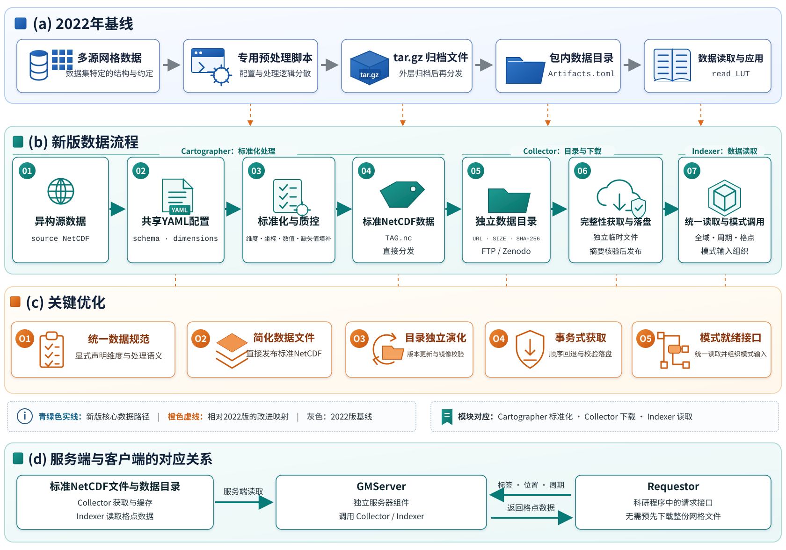

# 版本称谓逐处修改对照
仅统一版本称谓，保留实际发表年份、数据日期、章节逻辑与实验内容。

## GriddingMachine论文初稿_v0.3.md

第13行

修改前：地球系统模式依赖区域至全球尺度的网格数据进行参数初始化及结果验证。尽管当前数据大多已采用NetCDF、HDF、GeoTIFF等标准格式，不同数据源在处理规则、单位、数据标识和网络分发方式等方面仍存在差异，研究人员往往需要针对各自模式重复整理和维护数据库，增加了模式持续更新与验证的工作量。本文在2022版GriddingMachine（v0.2）的基础上，围绕数据预处理、分发和读取进行进一步改进。在数据预处理方面，新版GriddingMachine（v0.5）提供了标准化的数据处理流程，以便数据提供方进行数据标准化及验证。在数据分发方面，我们将定期更新的数据库文件上传至Zenodo，以保证每个版本的数据库的可追溯性；同时，我们将NetCDF数据文件上传至Zenodo和ScienceDB上，降低数据的获取难度。在数据读取方面，我们进一步提供了读取多源数据集合的功能，例如一次性获取陆面模式所需的初始化参数和气象驱动，为模式运行提供更便利的输入。新版GriddingMachine实现了数据IO功能（如数据处理和读取）和数据分发（如数据库和数据文件）的分离，使得新数据的更新独立于软件版本。此外，我们还完善了Matlab、Octave、Python和R语言对新版数据的自动下载支持，并新增C和Fortran语言的自动下载支持，以更好地服务地球科学研究与应用。

修改后：地球系统模式依赖区域至全球尺度的网格数据进行参数初始化及结果验证。尽管当前数据大多已采用NetCDF、HDF、GeoTIFF等标准格式，不同数据源在处理规则、单位、数据标识和网络分发方式等方面仍存在差异，研究人员往往需要针对各自模式重复整理和维护数据库，增加了模式持续更新与验证的工作量。本文在GriddingMachine（v0.2）的基础上，围绕数据预处理、分发和读取进行进一步改进。在数据预处理方面，新版GriddingMachine（v0.5）提供了标准化的数据处理流程，以便数据提供方进行数据标准化及验证。在数据分发方面，我们将定期更新的数据库文件上传至Zenodo，以保证每个版本的数据库的可追溯性；同时，我们将NetCDF数据文件上传至Zenodo和ScienceDB上，降低数据的获取难度。在数据读取方面，我们进一步提供了读取多源数据集合的功能，例如一次性获取陆面模式所需的初始化参数和气象驱动，为模式运行提供更便利的输入。新版GriddingMachine实现了数据IO功能（如数据处理和读取）和数据分发（如数据库和数据文件）的分离，使得新数据的更新独立于软件版本。此外，我们还完善了Matlab、Octave、Python和R语言对新版数据的自动下载支持，并新增C和Fortran语言的自动下载支持，以更好地服务地球科学研究与应用。

第29行

修改前：Earth system models depend on gridded data at regional to global scales for parameter initialization and evaluation of simulation results. Although most datasets use standard formats such as NetCDF, HDF, and GeoTIFF, differences in processing rules, units, data identifiers, and distribution methods still require researchers to organize and maintain databases for individual models, adding to the work of continued model development and evaluation. Building on GriddingMachine v0.2 released in 2022, the updated framework (v0.5) improves data preprocessing, distribution, and reading. A standardized processing workflow enables data providers to prepare and verify their datasets. Regularly updated database catalogs are archived on Zenodo to make each catalog version traceable, while NetCDF data files are shared through Zenodo and ScienceDB to facilitate access. Reading interfaces support collections of data from multiple sources, allowing initialization parameters and meteorological forcing for a land surface model to be obtained in a single call. The updated framework separates data input and output operations, including processing and reading, from the distribution of catalogs and data files, so that new data can be added independently of software releases. Automatic downloading of the updated data has also been improved for Matlab, Octave, Python, and R, with new support for C and Fortran, to better serve Earth science research and applications.

修改后：Earth system models depend on gridded data at regional to global scales for parameter initialization and evaluation of simulation results. Although most datasets use standard formats such as NetCDF, HDF, and GeoTIFF, differences in processing rules, units, data identifiers, and distribution methods still require researchers to organize and maintain databases for individual models, adding to the work of continued model development and evaluation. Building on GriddingMachine v0.2, the updated framework (v0.5) improves data preprocessing, distribution, and reading. A standardized processing workflow enables data providers to prepare and verify their datasets. Regularly updated database catalogs are archived on Zenodo to make each catalog version traceable, while NetCDF data files are shared through Zenodo and ScienceDB to facilitate access. Reading interfaces support collections of data from multiple sources, allowing initialization parameters and meteorological forcing for a land surface model to be obtained in a single call. The updated framework separates data input and output operations, including processing and reading, from the distribution of catalogs and data files, so that new data can be added independently of software releases. Automatic downloading of the updated data has also been improved for Matlab, Octave, Python, and R, with new support for C and Fortran, to better serve Earth science research and applications.

第52行

修改前：

修改后：

第54行

修改前：**图1 GriddingMachine从2022版到新版的数据流程与模块协作** （a）2022版以数据集专用脚本、`tar.gz`文件、包内数据目录和读取函数`read_LUT`构成数据预处理、分发与读取路径；（b）新版保留从源数据到模式输入的连续流程，Cartographer完成配置驱动的标准化处理，Collector依据独立目录获取和缓存文件，Indexer读取标准化数据并组织模式输入；（c）O1—O5依次表示统一数据规范、简化数据文件、目录独立维护、完整性核验与获取，以及模式输入组织，橙色虚线标示其与数据流程的对应关系；（d）GMServer在服务端复用Collector与Indexer，Requestor按数据标签、经纬度和周期发送请求并接收格点数据，科研程序无需预先下载整份网格文件。

修改后：**图1 GriddingMachine从v0.2版到新版的数据流程与模块协作** （a）v0.2版以数据集专用脚本、`tar.gz`文件、包内数据目录和读取函数`read_LUT`构成数据预处理、分发与读取路径；（b）新版保留从源数据到模式输入的连续流程，Cartographer完成配置驱动的标准化处理，Collector依据独立目录获取和缓存文件，Indexer读取标准化数据并组织模式输入；（c）O1—O5依次表示统一数据规范、简化数据文件、目录独立维护、完整性核验与获取，以及模式输入组织，橙色虚线标示其与数据流程的对应关系；（d）GMServer在服务端复用Collector与Indexer，Requestor按数据标签、经纬度和周期发送请求并接收格点数据，科研程序无需预先下载整份网格文件。

第56行

修改前：**Fig. 1 Data workflows and module interactions from the 2022 GriddingMachine release to the updated framework.** (a) The 2022 release linked dataset-specific preprocessing, `tar.gz` distribution, an in-package catalog, and `read_LUT`. (b) Cartographer standardizes source data using shared configurations, Collector retrieves and caches files using an independent catalog, and Indexer reads standardized data and assembles model inputs. (c) O1--O5 summarize updates to data specifications, file distribution, independent catalog maintenance, integrity-verified acquisition, and model-input organization. Orange dashed lines link these updates to the workflow. (d) GMServer uses Collector and Indexer on the server. Requestor sends a data label, coordinates, and a cycle index, then receives grid-cell data without downloading the full gridded file.

修改后：**Fig. 1 Data workflows and module interactions from GriddingMachine v0.2 to the updated framework.** (a) The v0.2 release linked dataset-specific preprocessing, `tar.gz` distribution, an in-package catalog, and `read_LUT`. (b) Cartographer standardizes source data using shared configurations, Collector retrieves and caches files using an independent catalog, and Indexer reads standardized data and assembles model inputs. (c) O1--O5 summarize updates to data specifications, file distribution, independent catalog maintenance, integrity-verified acquisition, and model-input organization. Orange dashed lines link these updates to the workflow. (d) GMServer uses Collector and Indexer on the server. Requestor sends a data label, coordinates, and a cycle index, then receives grid-cell data without downloading the full gridded file.

第84行

修改前：表1对比2022版与新版在数据生产、分发、读取和跨语言获取方面的主要差异。

修改后：表1对比v0.2版与新版在数据生产、分发、读取和跨语言获取方面的主要差异。

第86行

修改前：**表1 2022版与新版GriddingMachine的功能和技术路线比较**

修改后：**表1 v0.2版与新版GriddingMachine的功能和技术路线比较**

第88行

修改前：**Table 1 Comparison between the 2022 release and the updated GriddingMachine.**

修改后：**Table 1 Comparison between the v0.2 release and the updated GriddingMachine.**

第90行

修改前：| 更新环节 | 2022版 | 新版 |

修改后：| 更新环节 | v0.2版 | 新版 |

第144行

修改前：网格读取提供各变量的数值，参数和气象驱动接口则将这些数值按字段、时间与量纲关系组织为模式输入。本文所称“模式就绪”，是指标准化数据经过格点提取、参数融合、时间轴构建和量纲换算后，能够满足Emerald初始化接口的数据结构要求。2022版主要通过标签提供基础数据访问[5]，新版进一步组合多源数据，形成可由模式直接调用的输入，使科研程序能够复用数据及其组织方法。完整调用示例见补充材料。

修改后：网格读取提供各变量的数值，参数和气象驱动接口则将这些数值按字段、时间与量纲关系组织为模式输入。本文所称“模式就绪”，是指标准化数据经过格点提取、参数融合、时间轴构建和量纲换算后，能够满足Emerald初始化接口的数据结构要求。v0.2版主要通过标签提供基础数据访问[5]，新版进一步组合多源数据，形成可由模式直接调用的输入，使科研程序能够复用数据及其组织方法。完整调用示例见补充材料。

第279行

修改前：### 5.1 相对2022版的更新与科研用途

修改后：### 5.1 相对v0.2版的更新与科研用途

第281行

修改前：2022版GriddingMachine通过统一网格、变量和标签提供多源数据访问[5]，本研究进一步关注数据持续更新中的重复维护。31组处理实例与OISST结果表明，源数据在维度、坐标和数值上的差异可由配置描述，并由通用程序处理；ELEV重复处理结果则表明，已有标准化数据经过同一流程后仍可保持原值。将处理规则与数据文件一同维护，使新增或更新数据能够复用已有转换程序。镜像调整或文件修订后，可单独更新目录中的分发信息，模式程序继续按标签访问数据。

修改后：v0.2版GriddingMachine通过统一网格、变量和标签提供多源数据访问[5]，本研究进一步关注数据持续更新中的重复维护。31组处理实例与OISST结果表明，源数据在维度、坐标和数值上的差异可由配置描述，并由通用程序处理；ELEV重复处理结果则表明，已有标准化数据经过同一流程后仍可保持原值。将处理规则与数据文件一同维护，使新增或更新数据能够复用已有转换程序。镜像调整或文件修订后，可单独更新目录中的分发信息，模式程序继续按标签访问数据。

第307行

修改前：本文针对多源网格数据在转换、分发和模式接入中需要重复整理与维护的问题，更新了2022版GriddingMachine。新版通过共享配置记录源数据处理规则，利用独立目录维护标签、分发地址和文件完整性信息，并将统一读取的数据进一步组织为陆面参数与气象驱动。同时完善Matlab、Octave、Python和R对新版数据的自动下载支持，新增C和Fortran支持，使不同编程环境能够通过URL或数据标签获取标准化文件。

修改后：本文针对多源网格数据在转换、分发和模式接入中需要重复整理与维护的问题，更新了v0.2版GriddingMachine。新版通过共享配置记录源数据处理规则，利用独立目录维护标签、分发地址和文件完整性信息，并将统一读取的数据进一步组织为陆面参数与气象驱动。同时完善Matlab、Octave、Python和R对新版数据的自动下载支持，新增C和Fortran支持，使不同编程环境能够通过URL或数据标签获取标准化文件。

## overleaf/main.tex

第52行

修改前：地球系统模式依赖区域至全球尺度的网格数据进行参数初始化及结果验证。尽管当前数据大多已采用NetCDF、HDF、GeoTIFF等标准格式，不同数据源在处理规则、单位、数据标识和网络分发方式等方面仍存在差异，研究人员往往需要针对各自模式重复整理和维护数据库，增加了模式持续更新与验证的工作量。本文在2022版GriddingMachine（v0.2）的基础上，围绕数据预处理、分发和读取进行进一步改进。在数据预处理方面，新版GriddingMachine（v0.5）提供了标准化的数据处理流程，以便数据提供方进行数据标准化及验证。在数据分发方面，我们将定期更新的数据库文件上传至Zenodo，以保证每个版本的数据库的可追溯性；同时，我们将NetCDF数据文件上传至Zenodo和ScienceDB上，降低数据的获取难度。在数据读取方面，我们进一步提供了读取多源数据集合的功能，例如一次性获取陆面模式所需的初始化参数和气象驱动，为模式运行提供更便利的输入。新版GriddingMachine实现了数据IO功能（如数据处理和读取）和数据分发（如数据库和数据文件）的分离，使得新数据的更新独立于软件版本。此外，我们还完善了Matlab、Octave、Python和R语言对新版数据的自动下载支持，并新增C和Fortran语言的自动下载支持，以更好地服务地球科学研究与应用。

修改后：地球系统模式依赖区域至全球尺度的网格数据进行参数初始化及结果验证。尽管当前数据大多已采用NetCDF、HDF、GeoTIFF等标准格式，不同数据源在处理规则、单位、数据标识和网络分发方式等方面仍存在差异，研究人员往往需要针对各自模式重复整理和维护数据库，增加了模式持续更新与验证的工作量。本文在GriddingMachine（v0.2）的基础上，围绕数据预处理、分发和读取进行进一步改进。在数据预处理方面，新版GriddingMachine（v0.5）提供了标准化的数据处理流程，以便数据提供方进行数据标准化及验证。在数据分发方面，我们将定期更新的数据库文件上传至Zenodo，以保证每个版本的数据库的可追溯性；同时，我们将NetCDF数据文件上传至Zenodo和ScienceDB上，降低数据的获取难度。在数据读取方面，我们进一步提供了读取多源数据集合的功能，例如一次性获取陆面模式所需的初始化参数和气象驱动，为模式运行提供更便利的输入。新版GriddingMachine实现了数据IO功能（如数据处理和读取）和数据分发（如数据库和数据文件）的分离，使得新数据的更新独立于软件版本。此外，我们还完善了Matlab、Octave、Python和R语言对新版数据的自动下载支持，并新增C和Fortran语言的自动下载支持，以更好地服务地球科学研究与应用。

第69行

修改前：Earth system models depend on gridded data at regional to global scales for parameter initialization and evaluation of simulation results. Although most datasets use standard formats such as NetCDF, HDF, and GeoTIFF, differences in processing rules, units, data identifiers, and distribution methods still require researchers to organize and maintain databases for individual models, adding to the work of continued model development and evaluation. Building on GriddingMachine v0.2 released in 2022, the updated framework (v0.5) improves data preprocessing, distribution, and reading. A standardized processing workflow enables data providers to prepare and verify their datasets. Regularly updated database catalogs are archived on Zenodo to make each catalog version traceable, while NetCDF data files are shared through Zenodo and ScienceDB to facilitate access. Reading interfaces support collections of data from multiple sources, allowing initialization parameters and meteorological forcing for a land surface model to be obtained in a single call. The updated framework separates data input and output operations, including processing and reading, from the distribution of catalogs and data files, so that new data can be added independently of software releases. Automatic downloading of the updated data has also been improved for Matlab, Octave, Python, and R, with new support for C and Fortran, to better serve Earth science research and applications.

修改后：Earth system models depend on gridded data at regional to global scales for parameter initialization and evaluation of simulation results. Although most datasets use standard formats such as NetCDF, HDF, and GeoTIFF, differences in processing rules, units, data identifiers, and distribution methods still require researchers to organize and maintain databases for individual models, adding to the work of continued model development and evaluation. Building on GriddingMachine v0.2, the updated framework (v0.5) improves data preprocessing, distribution, and reading. A standardized processing workflow enables data providers to prepare and verify their datasets. Regularly updated database catalogs are archived on Zenodo to make each catalog version traceable, while NetCDF data files are shared through Zenodo and ScienceDB to facilitate access. Reading interfaces support collections of data from multiple sources, allowing initialization parameters and meteorological forcing for a land surface model to be obtained in a single call. The updated framework separates data input and output operations, including processing and reading, from the distribution of catalogs and data files, so that new data can be added independently of software releases. Automatic downloading of the updated data has also been improved for Matlab, Octave, Python, and R, with new support for C and Fortran, to better serve Earth science research and applications.

第100行

修改前：\caption{\textbf{GriddingMachine从2022版到新版的数据流程与模块协作} （a）2022版以数据集专用脚本、\allowbreak{}\nolinkurl{tar.gz}文件、\allowbreak{}包内数据目录和读取函数\nolinkurl{read_LUT}构成数据预处理、\allowbreak{}分发与读取路径；（b）新版保留从源数据到模式输入的连续流程，Cartographer完成配置驱动的标准化处理，Collector依据独立目录获取和缓存文件，Indexer读取标准化数据并组织模式输入；（c）O1—O5依次表示统一数据规范、\allowbreak{}简化数据文件、\allowbreak{}目录独立维护、\allowbreak{}完整性核验与获取，以及模式输入组织，橙色虚线标示其与数据流程的对应关系；（d）GMServer在服务端复用Collector与Indexer，Requestor按数据标签、\allowbreak{}经纬度和周期发送请求并接收格点数据，科研程序无需预先下载整份网格文件。}

修改后：\caption{\textbf{GriddingMachine从v0.2版到新版的数据流程与模块协作} （a）v0.2版以数据集专用脚本、\allowbreak{}\nolinkurl{tar.gz}文件、\allowbreak{}包内数据目录和读取函数\nolinkurl{read_LUT}构成数据预处理、\allowbreak{}分发与读取路径；（b）新版保留从源数据到模式输入的连续流程，Cartographer完成配置驱动的标准化处理，Collector依据独立目录获取和缓存文件，Indexer读取标准化数据并组织模式输入；（c）O1—O5依次表示统一数据规范、\allowbreak{}简化数据文件、\allowbreak{}目录独立维护、\allowbreak{}完整性核验与获取，以及模式输入组织，橙色虚线标示其与数据流程的对应关系；（d）GMServer在服务端复用Collector与Indexer，Requestor按数据标签、\allowbreak{}经纬度和周期发送请求并接收格点数据，科研程序无需预先下载整份网格文件。}

第101行

修改前：\caption*{\textbf{Fig. 1 Data workflows and module interactions from the 2022 GriddingMachine release to the updated framework.} (a) The 2022 release linked dataset-specific preprocessing, \nolinkurl{tar.gz} distribution, an in-package catalog, and \nolinkurl{read_LUT}. (b) Cartographer standardizes source data using shared configurations, Collector retrieves and caches files using an independent catalog, and Indexer reads standardized data and assembles model inputs. (c) O1--O5 summarize updates to data specifications, file distribution, independent catalog maintenance, integrity-verified acquisition, and model-input organization. Orange dashed lines link these updates to the workflow. (d) GMServer uses Collector and Indexer on the server. Requestor sends a data label, coordinates, and a cycle index, then receives grid-cell data without downloading the full gridded file.}

修改后：\caption*{\textbf{Fig. 1 Data workflows and module interactions from GriddingMachine v0.2 to the updated framework.} (a) The v0.2 release linked dataset-specific preprocessing, \nolinkurl{tar.gz} distribution, an in-package catalog, and \nolinkurl{read_LUT}. (b) Cartographer standardizes source data using shared configurations, Collector retrieves and caches files using an independent catalog, and Indexer reads standardized data and assembles model inputs. (c) O1--O5 summarize updates to data specifications, file distribution, independent catalog maintenance, integrity-verified acquisition, and model-input organization. Orange dashed lines link these updates to the workflow. (d) GMServer uses Collector and Indexer on the server. Requestor sends a data label, coordinates, and a cycle index, then receives grid-cell data without downloading the full gridded file.}

第134行

修改前：表1对比2022版与新版在数据生产、分发、读取和跨语言获取方面的主要差异。

修改后：表1对比v0.2版与新版在数据生产、分发、读取和跨语言获取方面的主要差异。

第141行

修改前：\caption*{\textbf{表1 2022版与新版GriddingMachine的功能和技术路线比较}}

修改后：\caption*{\textbf{表1 v0.2版与新版GriddingMachine的功能和技术路线比较}}

第142行

修改前：\caption*{\textbf{Table 1 Comparison between the 2022 release and the updated GriddingMachine.}}

修改后：\caption*{\textbf{Table 1 Comparison between the v0.2 release and the updated GriddingMachine.}}

第145行

修改前：\textbf{更新环节} & \textbf{2022版} & \textbf{新版} \\

修改后：\textbf{更新环节} & \textbf{v0.2版} & \textbf{新版} \\

第223行

修改前：网格读取提供各变量的数值，参数和气象驱动接口则将这些数值按字段、时间与量纲关系组织为模式输入。本文所称“模式就绪”，是指标准化数据经过格点提取、参数融合、时间轴构建和量纲换算后，能够满足Emerald初始化接口的数据结构要求。2022版主要通过标签提供基础数据访问\cite{ref5}，新版进一步组合多源数据，形成可由模式直接调用的输入，使科研程序能够复用数据及其组织方法。完整调用示例见补充材料。

修改后：网格读取提供各变量的数值，参数和气象驱动接口则将这些数值按字段、时间与量纲关系组织为模式输入。本文所称“模式就绪”，是指标准化数据经过格点提取、参数融合、时间轴构建和量纲换算后，能够满足Emerald初始化接口的数据结构要求。v0.2版主要通过标签提供基础数据访问\cite{ref5}，新版进一步组合多源数据，形成可由模式直接调用的输入，使科研程序能够复用数据及其组织方法。完整调用示例见补充材料。

第354行

修改前：\subsection{相对2022版的更新与科研用途}

修改后：\subsection{相对v0.2版的更新与科研用途}

第355行

修改前：2022版GriddingMachine通过统一网格、变量和标签提供多源数据访问\cite{ref5}，本研究进一步关注数据持续更新中的重复维护。31组处理实例与OISST结果表明，源数据在维度、坐标和数值上的差异可由配置描述，并由通用程序处理；ELEV重复处理结果则表明，已有标准化数据经过同一流程后仍可保持原值。将处理规则与数据文件一同维护，使新增或更新数据能够复用已有转换程序。镜像调整或文件修订后，可单独更新目录中的分发信息，模式程序继续按标签访问数据。

修改后：v0.2版GriddingMachine通过统一网格、变量和标签提供多源数据访问\cite{ref5}，本研究进一步关注数据持续更新中的重复维护。31组处理实例与OISST结果表明，源数据在维度、坐标和数值上的差异可由配置描述，并由通用程序处理；ELEV重复处理结果则表明，已有标准化数据经过同一流程后仍可保持原值。将处理规则与数据文件一同维护，使新增或更新数据能够复用已有转换程序。镜像调整或文件修订后，可单独更新目录中的分发信息，模式程序继续按标签访问数据。

第377行

修改前：本文针对多源网格数据在转换、分发和模式接入中需要重复整理与维护的问题，更新了2022版GriddingMachine。新版通过共享配置记录源数据处理规则，利用独立目录维护标签、分发地址和文件完整性信息，并将统一读取的数据进一步组织为陆面参数与气象驱动。同时完善Matlab、Octave、Python和R对新版数据的自动下载支持，新增C和Fortran支持，使不同编程环境能够通过URL或数据标签获取标准化文件。

修改后：本文针对多源网格数据在转换、分发和模式接入中需要重复整理与维护的问题，更新了v0.2版GriddingMachine。新版通过共享配置记录源数据处理规则，利用独立目录维护标签、分发地址和文件完整性信息，并将统一读取的数据进一步组织为陆面参数与气象驱动。同时完善Matlab、Octave、Python和R对新版数据的自动下载支持，新增C和Fortran支持，使不同编程环境能够通过URL或数据标签获取标准化文件。

## figures/图1_GriddingMachine总体架构_终稿.svg

第24行

修改前：  <!-- (a) 2022 baseline -->

修改后：  <!-- (a) GriddingMachine v0.2 baseline -->

第27行

修改前：  <text x="70" y="62" class="sans panel-title">(a) 2022年基线</text>

修改后：  <text x="70" y="62" class="sans panel-title">(a) v0.2基线</text>

第128行

修改前：    <text x="82" y="897" class="legend"><tspan fill="#14648d" font-weight="700">青绿色实线：</tspan>新版核心数据路径　|　<tspan fill="#d65f13" font-weight="700">橙色虚线：</tspan>相对2022版的改进映射　|　<tspan fill="#687078" font-weight="700">灰色：</tspan>2022版基线</text>

修改后：    <text x="82" y="897" class="legend"><tspan fill="#14648d" font-weight="700">青绿色实线：</tspan>新版核心数据路径　|　<tspan fill="#d65f13" font-weight="700">橙色虚线：</tspan>相对v0.2版的改进映射　|　<tspan fill="#687078" font-weight="700">灰色：</tspan>v0.2版基线</text>
